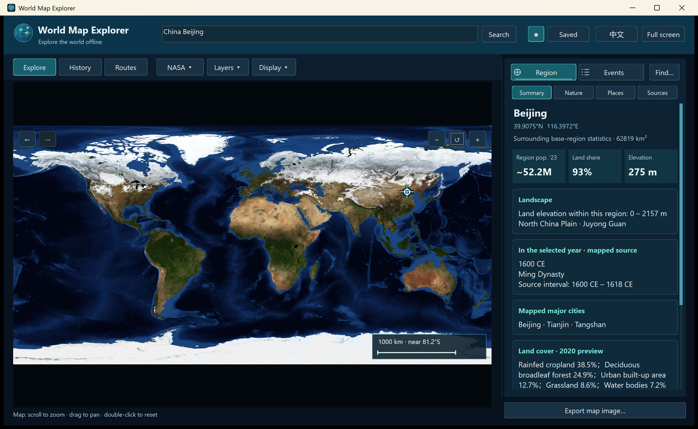
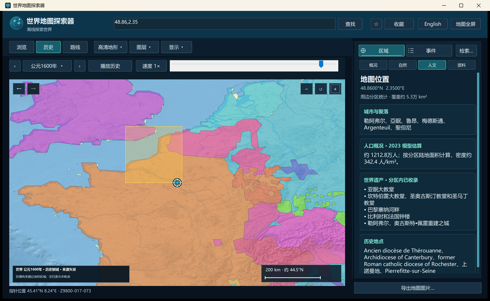
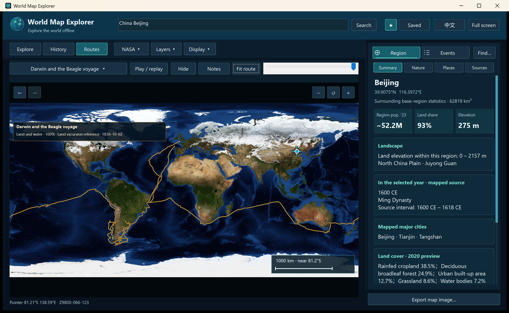

# World Map Explorer

Explore places, history and journeys on an offline world map.

**Windows 10 / 11 · x64 · English / 中文 · Version 1.28.0**

[Download for Windows](https://github.com/zaohong/world-map-explorer/releases/tag/v1.28.0) · [简体中文](README.md) · [Screenshot gallery](screenshots/README.md) · [Changes](CHANGELOG.md)

## Get started

Download **WorldMapExplorer-1.28.0.zip** from the [v1.28.0 release](https://github.com/zaohong/world-map-explorer/releases/tag/v1.28.0). Extract the complete folder and run **WorldMapExplorer-1.28.0.exe**. Keep `assets`, `data` and `licenses` beside it. Maps, search and everyday reference data are included; no installation or online account is required.

Choose **English** at the top right. Press **Ctrl+F** to search for a place, event, journey, year, grid ID or `latitude,longitude`. Try `China Beijing`, `London Ontario`, `1600` or `39.9,116.4`.

## Explore

| Feature | Included |
| --- | --- |
| Basemaps | Natural Earth terrain and detailed terrain; NASA Blue Marble with bundled detail tiles |
| Place search | 34,248 cities and 258 country / region reference points, with aliases and country-qualified queries |
| History | 5,424 nonzero years from 3400 BCE to 2024 CE, rendered from source validity intervals and vector geometry |
| Events | 346 records with keyword, category and year-range filters and source links |
| Journeys | 42 reference itineraries, voyages, expeditions and campaigns with playback, seeking and source notes |
| Layers | 2026 country / region categories, WorldPop 2023 population estimates and a 2020 land-cover preview |
| Location grid | 9,800, 39,200, 156,800 and 627,200 latitude / longitude cells |

The Explore, History and Routes workspaces keep relevant controls close to the map. Region reading has Summary, Nature, Places and Sources pages. Save up to 64 locations, rename or remove them, and undo changes. Windows running this version merge saved-place updates. Back / forward navigation and optional last-view restoration help you continue exploring; playback always restores paused.

Interface scaling follows Windows by default, with remembered 100%, 125%, 150% and 200% choices. PNG exports include legends and attribution and crop unused space outside the map.

| Historical boundaries, 1600 CE | HMS Beagle reference journey |
| --- | --- |
|  |  |

The Beagle itinerary preserves 596 source positions, 407 dated records and 13 gaps. Playback follows reference connection distance, rather than historical elapsed time or actual travel mileage.

All [14 gallery images](screenshots/README.md) show the released **1.28.0 application**. This release includes the bilingual interface shown here. Some source names, titles and database narratives retain their original language.

## Read the data correctly

Grid cells are not equal-area. A finer grid improves location granularity; population, terrain and other summaries mainly describe surrounding base regions from the 9,800-cell dataset, rather than the selected point or city. Population is modelled, not a census. Land cover is not soil composition.

Historical boundaries follow source validity intervals without interpolating missing borders. Blank areas mean no matching record; coverage and overlaps vary. Relationships are kept separate from territorial geometry. Journey lines are reference connections, and source gaps remain visible.

See [data sources and methods](docs/DATA_SOURCES.md), [journey sources](docs/ROUTE_SOURCES.md) and bundled `licenses/` for attribution and limitations.

## Source and verification

The desktop application uses C++17, Win32 and GDI/GDI+. [Current source](当前补丁/迭代工作/1.28.0/native), [build instructions](docs/BUILD.md), [validation scope](docs/VALIDATION.md) and [optional reconstruction inputs](SUPPLEMENTAL-DATA.md) are available in this repository. The complete runtime is distributed through Releases.

Third-party datasets retain their own licences and attribution. Natural Earth is public domain; the bundled notes cover WorldPop, GeoNames, Cliopatria and other sources. The application source retains the repository's existing licensing status; no separate open-source licence has been granted.
