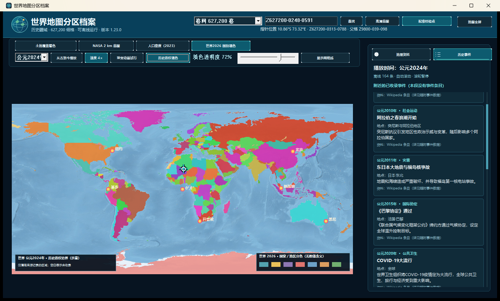
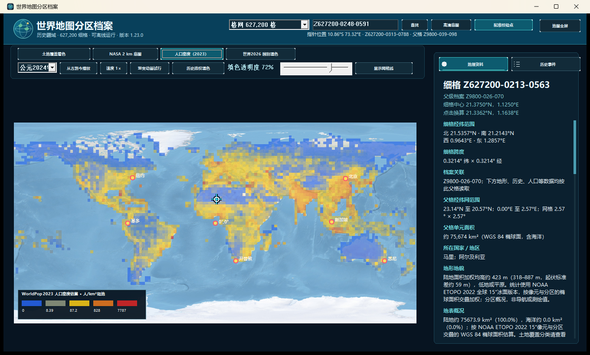
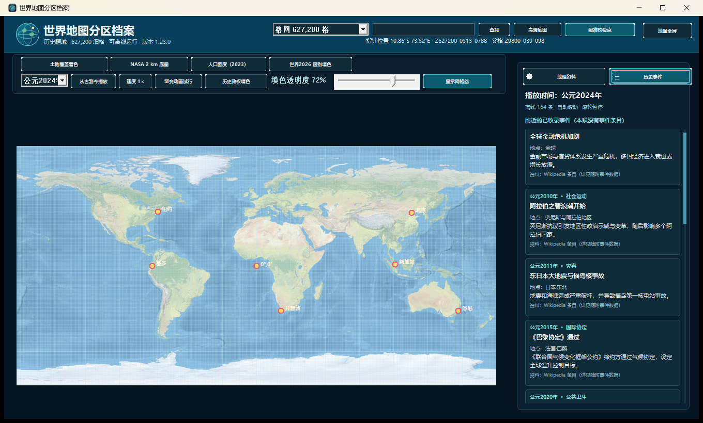
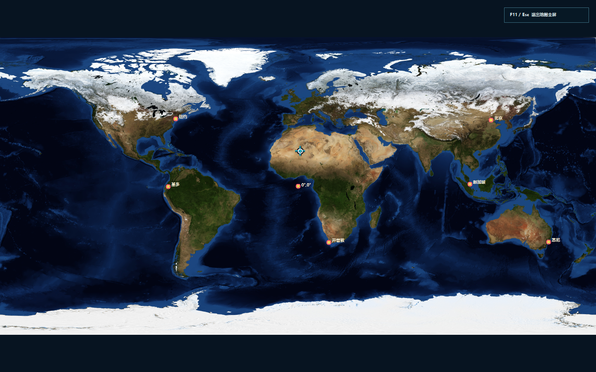

# 世界地图探索器

**离线世界地图 · 四级网格定位 · 历史与专题图层**

世界地图探索器是一款适用于 Windows 10/11 的离线地图工具。它把全球底图、多级经纬网格和历史及自然地理资料放在同一界面中，支持按网格编号、坐标、地点和土地覆盖类别定位与查询。

**当前公开版本：1.23.0** · [下载完整运行包](https://github.com/zaohong/world-map-explorer/releases/tag/v1.23.0) · [查看所有版本与附件](https://github.com/zaohong/world-map-explorer/releases)

## 界面预览

以下截图来自当前公开版本 1.23.0。完整界面与交互截图、自动检查记录见 [`1.23.0/qa`](./当前补丁/迭代工作/1.23.0/qa/)。

| 历史疆域与 2026 年国别分区 | 人口专题与网格定位 |
| --- | --- |
|  |  |

| 历史事件面板 | 全屏地图 |
| --- | --- |
|  |  |

## 功能一览

- **浏览地图：** Natural Earth 标准及高清底图、NASA Blue Marble 底图；支持缩放、平移和全屏查看。
- **定位网格：** 提供 9,800、39,200、156,800 和 627,200 格四档经纬网格；可按编号、经纬度、地点或土地覆盖类别搜索。
- **查看历史：** 浏览 601 个历史时间点，时间范围从公元前 3400 年至公元 2024 年；历史事件面板收录 164 条事件、45 个类别。
- **切换专题：** 查看历史政权、2026 年国家／地区分类、2023 年人口估算和 2020 年土地覆盖图层。
- **离线使用：** 地图、数据和运行资源随完整发行包提供，日常浏览无需联网。

## 网格与资料口径

四档网格按经纬度划分，并非等面积网格，单格实际面积会随纬度变化。选择更细网格可以更精细地定位，但不代表关联资料具有更高空间分辨率。区域信息中的地形、地点和人口等摘要主要按 9,800 格基础网格汇总；历史疆域与 2026 年国别图层有各自的数据口径，详见随包的数据说明。

人口图层采用 WorldPop 模型估算，不是人口普查；源数据在约南纬 60°至北纬 84°以外不提供估值。历史疆域资料在不同年代和地区的覆盖程度不一，图上空白表示来源数据没有匹配记录，不表示无人居住，也不构成现行主权或法律边界结论。国别分色用于地图区分，不表示数值高低。

## 下载与启动

1. 从 [v1.23.0 发布页](https://github.com/zaohong/world-map-explorer/releases/tag/v1.23.0) 下载 `WorldMapExplorer-1.23.0.zip`。
2. 完整解压后，进入 `WorldMapExplorer-1.23.0` 文件夹。
3. 双击 `WorldMapExplorer.exe`。请保留同目录中的 `assets`、`data`、`licenses` 和数据来源说明文件。

压缩包 SHA-256：`476C02639BEADC6D1F3A42915A8894BE36CCAE478D16283BB48808BE712B0979`。两份较大的原始输入数据可从同一 Release 下载；恢复路径、许可和校验值见 [`SUPPLEMENTAL-DATA.md`](./SUPPLEMENTAL-DATA.md)。它们用于重建输入或核对数据，运行程序不需要另行下载。

## 仓库内容

| 路径 | 内容 |
| --- | --- |
| [`当前补丁/迭代工作/1.23.0/native`](./当前补丁/迭代工作/1.23.0/native/) | Windows 主程序、专题数据生成工具及相关源码 |
| [`当前补丁/迭代工作/1.23.0/source-data`](./当前补丁/迭代工作/1.23.0/source-data/) | 历史疆域、历史事件、Natural Earth 输入和来源说明 |
| [`当前补丁/迭代工作/1.23.0/qa`](./当前补丁/迭代工作/1.23.0/qa/) | 自动检查源码、运行记录和 35 张界面截图 |
| [`当前补丁/迭代工作/1.22.0`](./当前补丁/迭代工作/1.22.0/) | 保留的旧版源码、截图和检查记录 |
| [`当前补丁/迭代工作/必要数据源`](./当前补丁/迭代工作/必要数据源/) | 原始数据说明和重建工具 |
| [`交接文档`](./交接文档/) | 架构、来源、校准和历史变更资料 |
| [`原始输入`](./原始输入/) | 项目保留的原始地图输入 |

Git 仓库包含应用源码、构建输入、检查工具、记录和截图；编译好的完整 Windows 运行目录以 Release 压缩包提供。克隆仓库可浏览项目文件，下载发行包可直接运行应用。

## 1.23.0 检查记录

以下数字是随 1.23.0 归档的检查结果：

- 真实窗口交互：794 项通过，0 项失败。
- 历史疆域抽样：4,250 项通过，0 项失败。
- 网格与坐标逻辑：270 项通过，0 项失败。
- 历史事件、底图素材校验及各专题界面截图均已归档。

检查明细见 [`运行与功能检查.md`](./当前补丁/迭代工作/1.23.0/运行与功能检查.md) 和 [`qa`](./当前补丁/迭代工作/1.23.0/qa/) 文件夹。这里列出的结果对应 1.23.0 归档，并非重新执行的测试。

## 数据来源与许可

第三方数据和资源保留各自的来源说明与许可，详见运行包内的 `DATA_SOURCES.md`、`licenses/` 和源码目录中的来源文件。WorldPop 数据按 CC BY 4.0 保留署名；Natural Earth 数据为公有领域资料。应用源码目前未单独指定开源许可证；公开浏览源码不代表取得未明确授权内容的再分发或商用许可。
