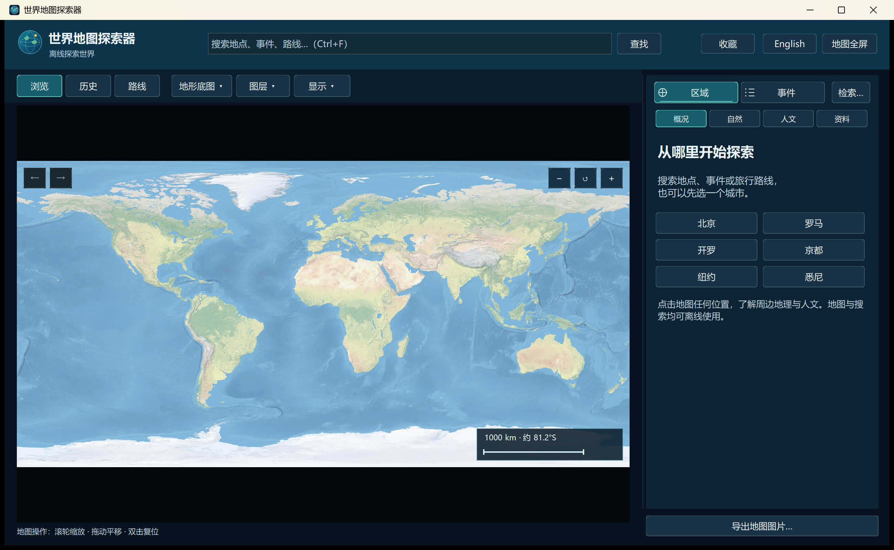
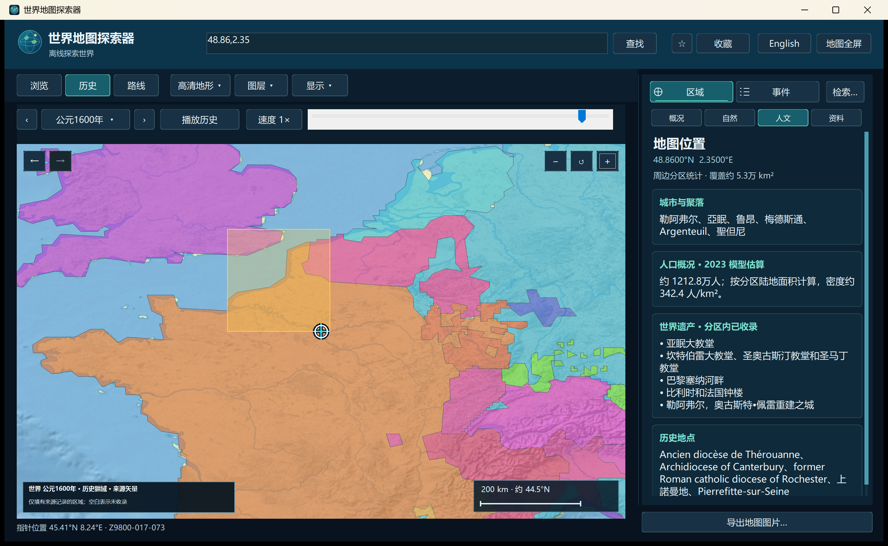
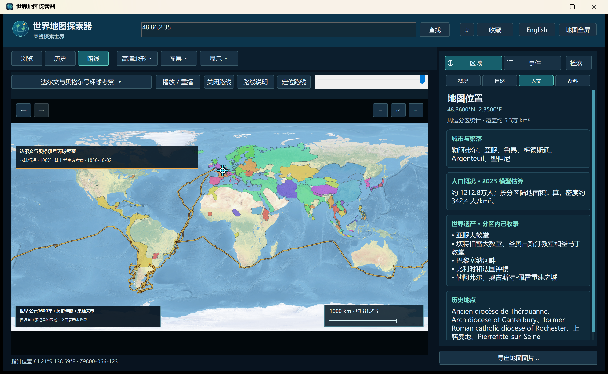
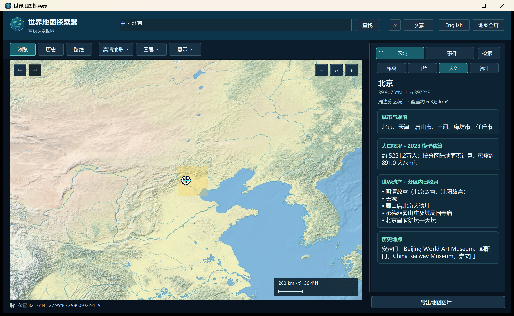
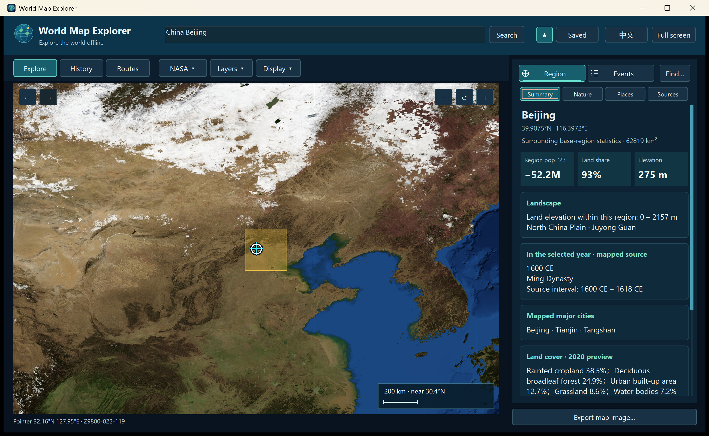

# 世界地图探索器 · World Map Explorer

在一张离线地图中，探索地点、历史与旅行路线。

**Windows 10 / 11 · 64 位 · 中文 / English · 当前版本 1.28.0**

[下载完整运行包](https://github.com/zaohong/world-map-explorer/releases/tag/v1.28.0) · [English](README.en.md) · [全部截图](screenshots/README.md) · [更新说明](CHANGELOG.md)

## 下载与开始

1. 从 [v1.28.0 Releases](https://github.com/zaohong/world-map-explorer/releases/tag/v1.28.0) 下载 **WorldMapExplorer-1.28.0.zip**。
2. 完整解压，运行文件夹中的 **WorldMapExplorer-1.28.0.exe**。
3. 保留同目录的 `assets`、`data` 和 `licenses`。地图、地点检索、历史与日常使用所需资料均已随包提供。

无需安装。可先点击“北京”“罗马”等推荐地点，也可以按 **Ctrl+F** 搜索。右上角 **English / 中文** 随时切换界面语言。

## 可以探索什么

| 内容 | 本版提供 |
| --- | --- |
| 地图 | Natural Earth 地形、高清地形与 NASA Blue Marble，支持随包细节瓦片、缩放、平移和全屏 |
| 地点 | 34,248 个城市及 258 个国家／地区参考点；支持中英文、别名、简繁检索与国家限定 |
| 历史 | 公元前 3400 年至公元 2024 年的 5,424 个非零年份，按来源有效年段显示矢量边界 |
| 事件 | 346 条事件，提供关键词、类别和年段筛选，以及可核对的资料链接 |
| 路线 | 42 条旅行、航海、远征和战役参考路线；可播放、拖动进度和阅读来源 |
| 专题 | 2026 国家／地区类别、WorldPop 2023 人口估算、2020 土地覆盖预览和分区地理人文资料 |
| 定位 | 9,800、39,200、156,800、627,200 格四档经纬网格，也可直接输入纬度和经度 |

## 新界面与日常使用

“浏览、历史、路线”分别提供适合当前任务的操作。区域资料分为“概况、自然、人文、资料”四页，原始记录和来源保留可查。

- **统一搜索**：地点、事件、路线、收藏和分区资料在一个窗口中查找；例如 `中国 北京`、`London Ontario`、`1600`、`39.9,116.4`。
- **继续探索**：返回／前进浏览位置，重开程序可恢复上次视图；历史和路线恢复时保持暂停。
- **本机收藏**：最多 64 个位置，可重命名、移除和撤销；同版本多个窗口合并更新。
- **适应屏幕**：界面默认跟随 Windows 缩放，也可选择 100%、125%、150%、200%；设置会保存。
- **地图快照**：导出带图例和资料来源的 PNG，裁去地图之外的留白。
- **显示与缓存**：底图、图层和显示设置分开管理，保留地图位置；瓦片、历史几何和阅读内容按需准备。

| 历史边界 · 1600 年欧洲 | “小猎犬号”参考路线 |
| --- | --- |
|  |  |

“小猎犬号”路线保留 596 个来源位置、407 个日期记录及 13 处资料缺口。进度按参考连线距离推进，不表示真实旅行耗时或实际里程。

| 地点与区域阅读 | 英文界面 |
| --- | --- |
|  |  |

以上截图全部来自本次发布的 **1.28.0 实际程序**。界面、主要操作和阅读标签支持中英文；部分原始地名、资料标题和长篇数据库叙述保留来源语言。[查看全部 14 张截图](screenshots/README.md)。

## 怎样理解资料

经纬网格不是等面积单元。细网格提升定位粒度，区域的人口、地形等摘要仍主要覆盖周边 9,800 格基础分区，不能当作点击位置或城市本身的统计。人口是模型估算；土地覆盖预览不等于土壤类型图。

历史边界按来源记录的有效年段展示，不在缺失年份之间推演疆域。空白表示来源未收录；不同来源可能重叠，历史关系记录与疆域几何分开处理。路线为有来源的参考示意，断开处保留资料缺口。

完整来源、方法和许可见 [DATA_SOURCES.md](docs/DATA_SOURCES.md)、[路线资料清单](docs/ROUTE_SOURCES.md) 及随包 `licenses/`。

## 源码、构建与检查

应用使用 C++17、Win32、GDI/GDI+。当前源码位于 [1.28.0/native](当前补丁/迭代工作/1.28.0/native)，重建步骤见 [构建说明](docs/BUILD.md)，本版检查范围见 [验证记录](docs/VALIDATION.md)。运行包与大型数据输入通过 Releases 提供，日常运行无需额外下载原始数据。

数据输入及恢复位置见 [SUPPLEMENTAL-DATA.md](SUPPLEMENTAL-DATA.md)。第三方数据各自遵循原许可；Natural Earth 为公有领域，WorldPop、GeoNames、Cliopatria 等来源的署名与许可随包保留。应用源码沿用原仓库的许可状态，尚未单独授予开源许可证。
