<!-- ENGLISH README SECTION -->
# World Map Explorer

**Offline world maps · Four grid levels · Historical and thematic layers**

World Map Explorer is a Windows 10/11 desktop application for browsing and querying a global map offline. It combines Natural Earth and NASA basemaps with coordinate-grid lookup, historical-boundary overlays, recorded events, population estimates, and 2020 land-cover categories.

[English](#world-map-explorer) · 简体中文说明见本页下方折叠部分。

## English UI preview

| NASA Blue Marble overview | 1914 historical boundaries on NASA |
| --- | --- |
| [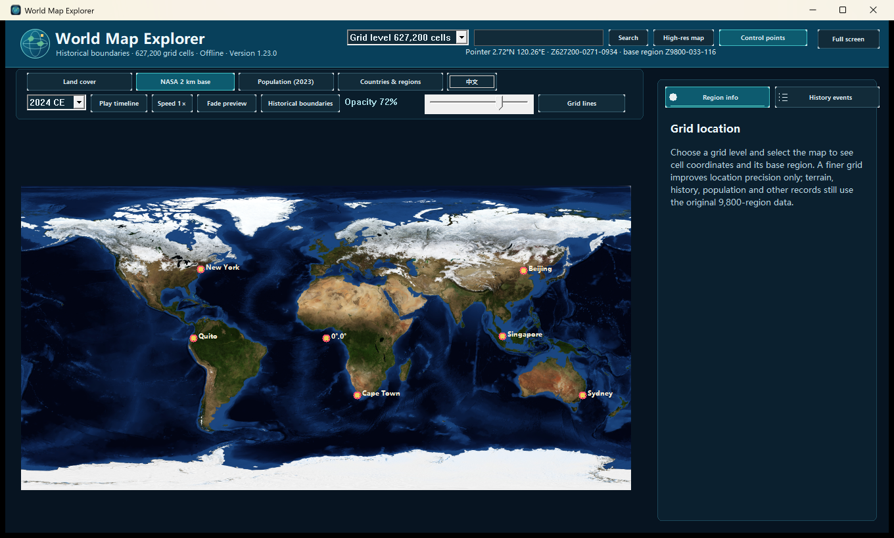](screenshots/en-preview/world-map-explorer-ui-en.png) | [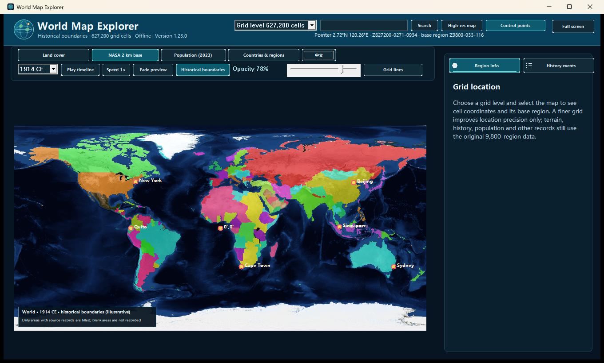](screenshots/en-preview/historical-boundaries-nasa-1914-en.png) |

These two images show a local preview of the bilingual interface. The downloadable **v1.23.0 release remains Chinese-only**; the bilingual program update has not been published. The large data files are unchanged, so region names and database narratives may still appear in Chinese.

## What it includes

- **Basemaps:** Natural Earth 10m and NASA Blue Marble, with additional high-resolution map detail available in the application.
- **Grid lookup:** 9,800, 39,200, 156,800, or 627,200 latitude/longitude cells. Search by grid ID, coordinates, place, or land-cover category.
- **Historical browsing:** 601 year points from 3400 BCE to 2024 CE, plus a timeline of 164 recorded events across 45 categories.
- **Thematic layers:** Historical boundaries, 2026 country and region categories, WorldPop 2023 population estimates, and 2020 land cover.
- **Map controls:** Zoom, pan, full-screen view, grid-line toggle, layer opacity, and historical playback.

## Data notes

The grid is based on latitude and longitude, so cells are not equal in area. The finer grid improves location precision; most terrain, place, and population summaries remain associated with the original 9,800-region dataset. Population values are model estimates, not census counts. Historical coverage varies by place and year; blank cells indicate no matching source record and do not imply an uninhabited area or a current legal border. Country colors are categorical and do not represent numeric values.

The project includes a 35-image gallery of the current release and a separate [English screenshot selection](screenshots/README.en.md). The full gallery is organized by basemap, thematic layer, year, zoom level, opacity, and grid-line state.

## Download and run

The current public release is **v1.23.0**. Download [WorldMapExplorer-1.23.0.zip](https://github.com/zaohong/world-map-explorer/releases/tag/v1.23.0), extract the complete folder, then run `WorldMapExplorer.exe`. Keep the bundled `assets`, `data`, and `licenses` folders beside the executable. The archive SHA-256 is `476C02639BEADC6D1F3A42915A8894BE36CCAE478D16283BB48808BE712B0979`.

## Repository and licensing

The repository contains application source, build inputs, QA records, data-source notes, and screenshots. The compiled Windows runtime is distributed through the Release archive. Third-party datasets retain their own licenses: WorldPop attribution is provided under CC BY 4.0, and Natural Earth data is public domain. The application source does not currently declare a separate open-source license; public source visibility does not grant additional redistribution or commercial rights.

---

简体中文说明（点击展开）

# 世界地图探索器

**离线世界地图 · 四级网格定位 · 历史与专题图层**

世界地图探索器是一款适用于 Windows 10/11 的离线地图工具。它把全球底图、多级经纬网格和历史及自然地理资料放在同一界面中，支持按网格编号、坐标、地点和土地覆盖类别定位与查询。

**当前公开版本：1.23.0** · [下载完整运行包](https://github.com/zaohong/world-map-explorer/releases/tag/v1.23.0) · [查看所有版本与附件](https://github.com/zaohong/world-map-explorer/releases)

> 说明：当前公开下载的 v1.23.0 仍是中文界面。上方英文界面截图来自尚未发布的本地双语预览；数据库中的地区名称与叙述暂未翻译，因此部分查询结果仍可能显示中文。

## 界面截图

以下展示图来自当前公开版本 1.23.0，按基础地图、专题图层和历史政权分类。纯底图与高清局部图使用 Natural Earth 10m 或 NASA 底图；网格档位为 627,200 格。历史政权填色、年份、透明度和网格线对照均有成组截图。

### 基础地图与专题

| Natural Earth 10m 全球底图 | NASA Blue Marble 全球底图 |
| --- | --- |
| [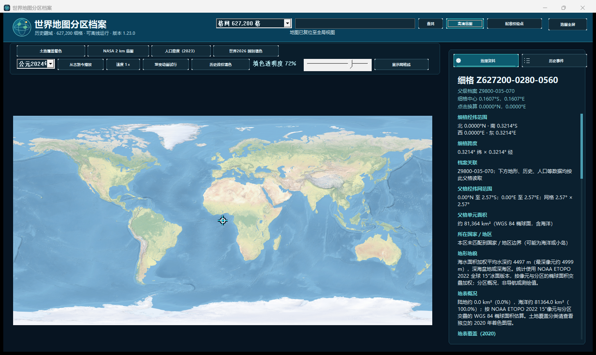](./screenshots/01-world-overview.png) | [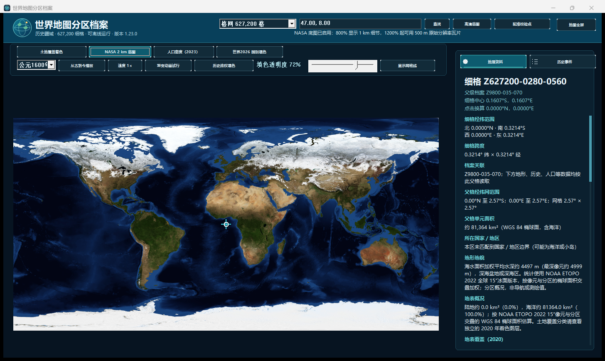](./screenshots/16-nasa-blue-marble.png) |

| 627,200 格 · 网格线开启 | 同一地点 · 网格线关闭 |
| --- | --- |
| [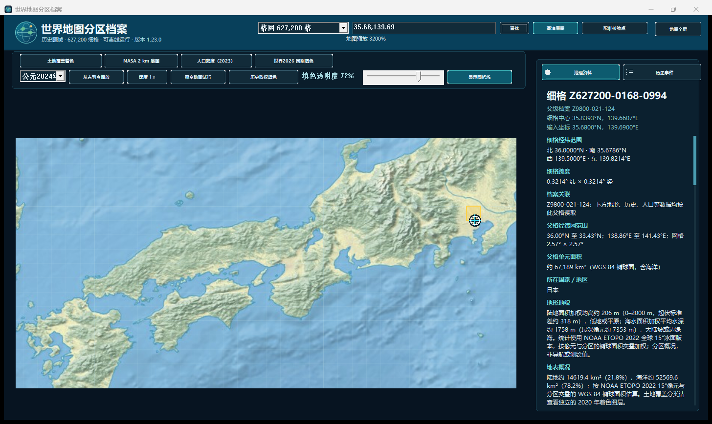](./screenshots/02-fine-grid-location.png) | [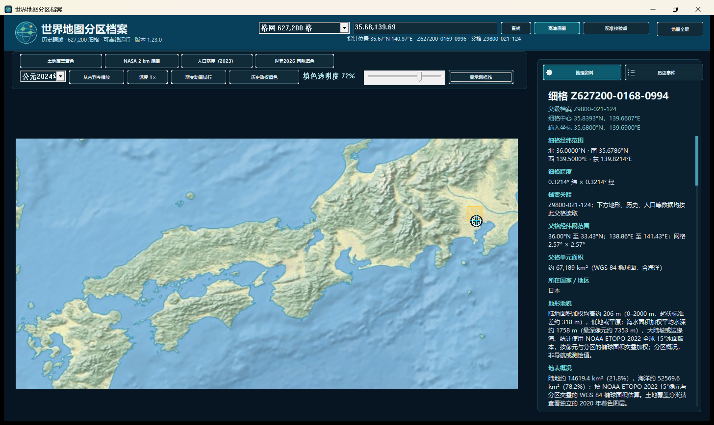](./screenshots/02a-fine-grid-location-no-gridlines.png) |

| 欧洲高清局部 | 非洲高清局部 |
| --- | --- |
| [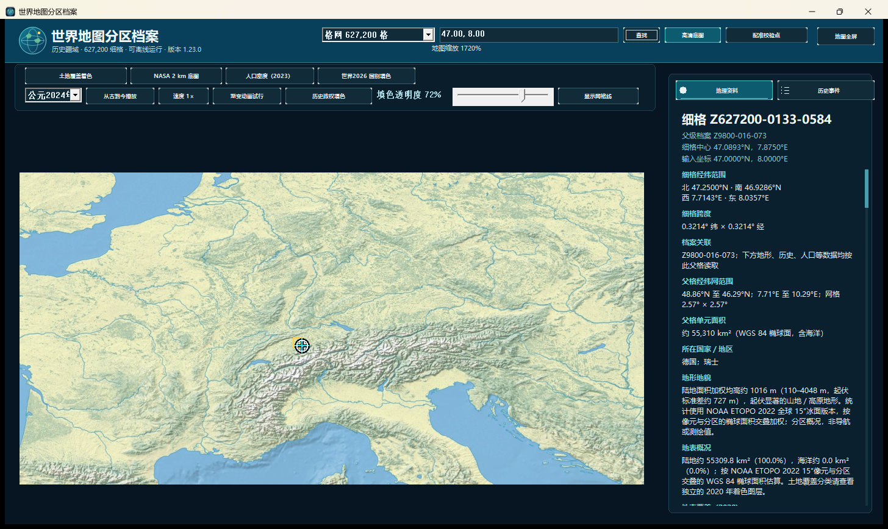](./screenshots/15-natural-earth-high-resolution.png) | [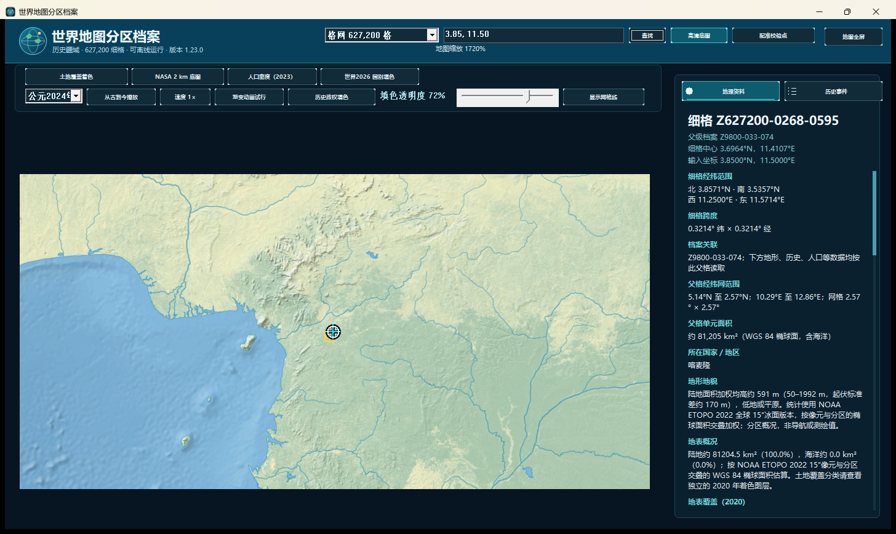](./screenshots/15a-natural-earth-africa-detail.png) |

| 安第斯山脉高清局部 | 喜马拉雅山脉高清局部 |
| --- | --- |
| [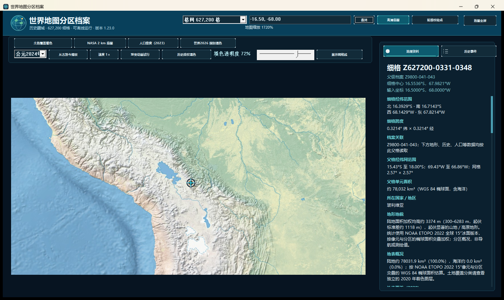](./screenshots/15b-natural-earth-andes-detail.png) | [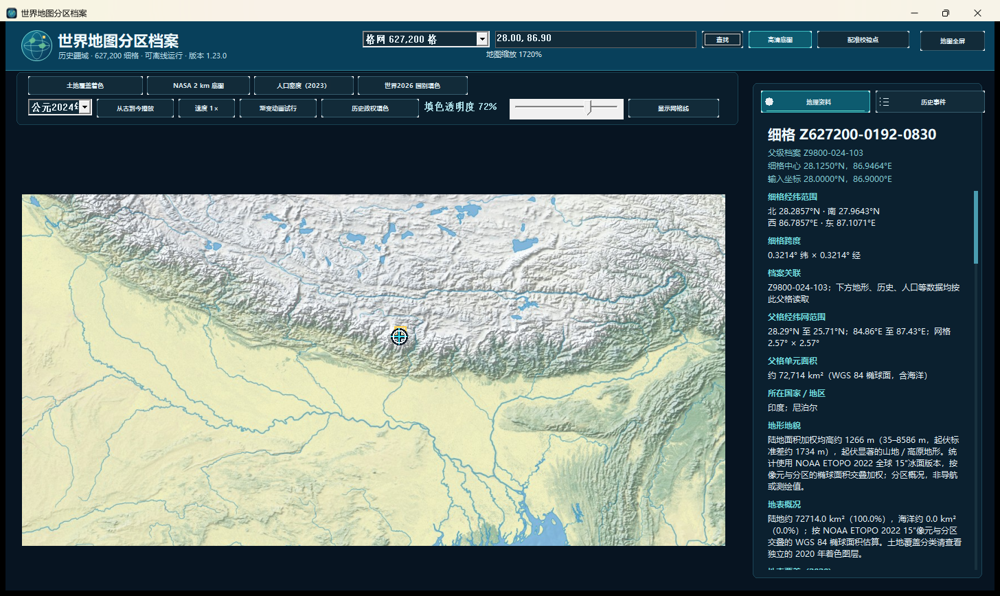](./screenshots/15c-natural-earth-himalaya-detail.png) |

| WorldPop 2023 人口 | 2020 年土地覆盖 |
| --- | --- |
| [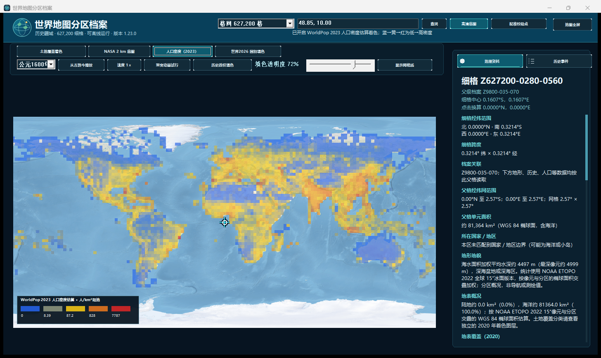](./screenshots/11-population-2023.png) | [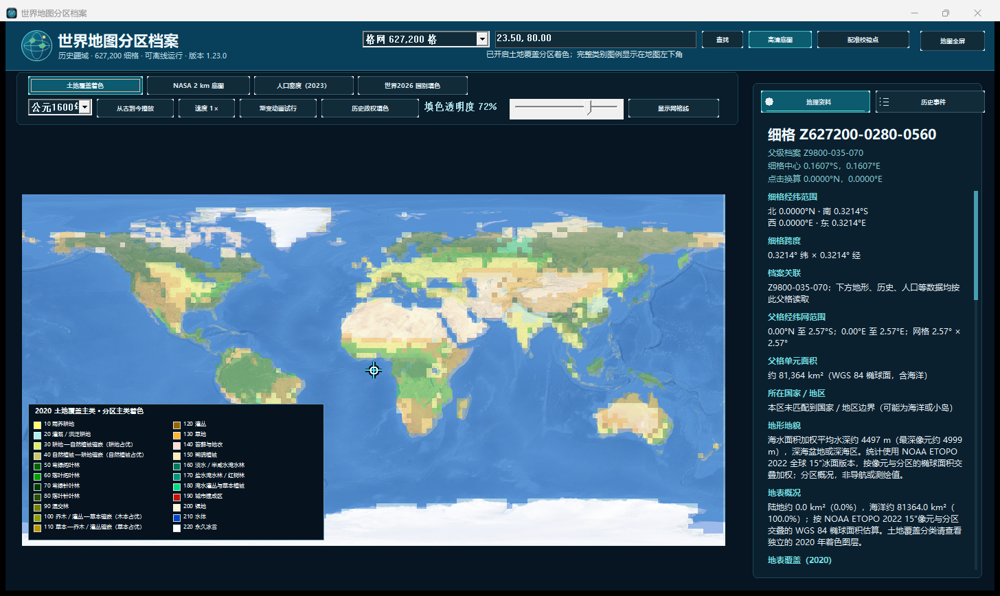](./screenshots/13-land-cover-2020.png) |

项目实际提供的是 2020 年土地覆盖图层（如植被、农地等类别），并非土壤成分或土壤类型图。人口与土地覆盖局部图、2026 年国别分区和 NASA 1 km／500 m 细节图见[完整画廊](./screenshots/README.md)。

### 历史政权与透明度

全球历史填色覆盖 8 个展示节点：公元前 1000 年、公元 476 年、公元 1000 年、公元 1200 年、公元 1600 年、公元 1800 年、公元 1914 年和公元 2024 年。完整年份序列与各时期原图见[历史政权截图画廊](./screenshots/README.md)。

| 公元 1600 年 · 默认 72% | 公元 1600 年 · NASA 底图 |
| --- | --- |
| [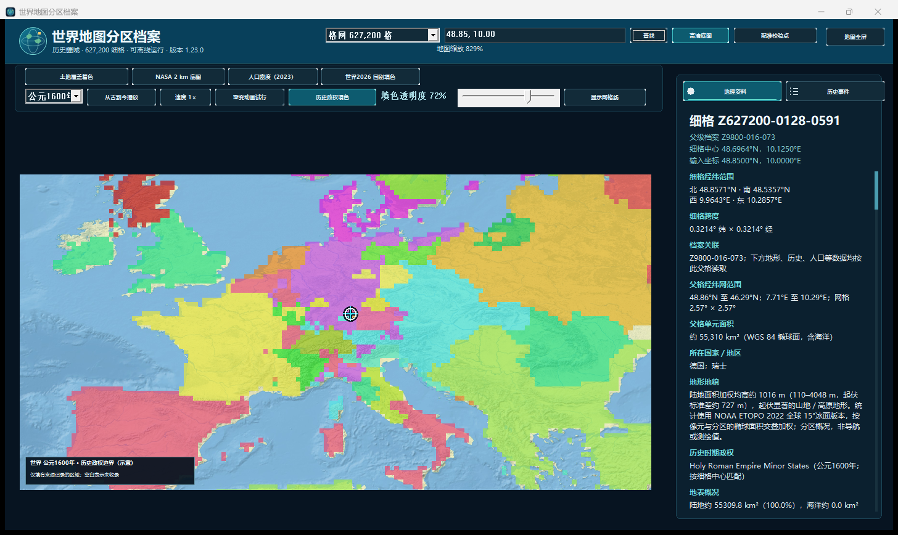](./screenshots/08-history-europe-1600-opacity-72.png) | [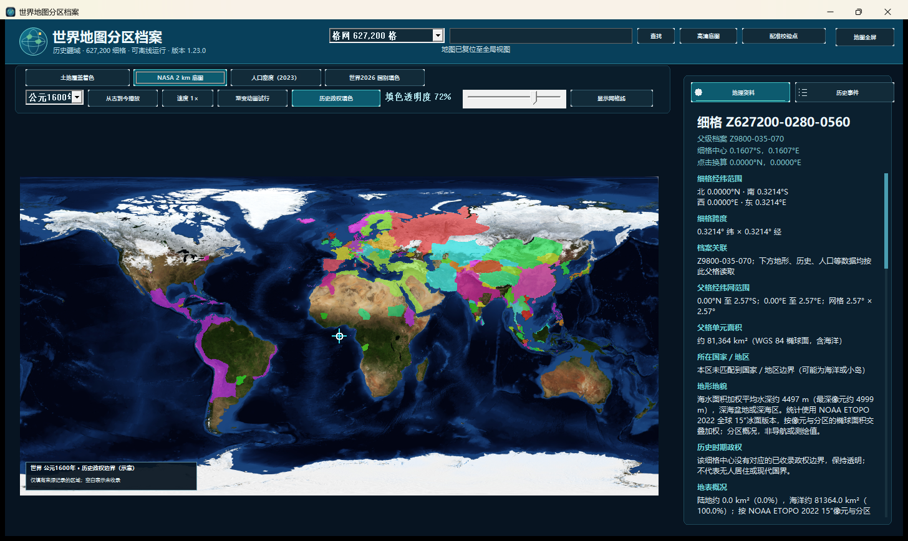](./screenshots/16a-history-1600-nasa-base.png) |

| 局部放大 · 60% | 局部放大 · 90% | 局部放大 · 100% |
| --- | --- | --- |
| [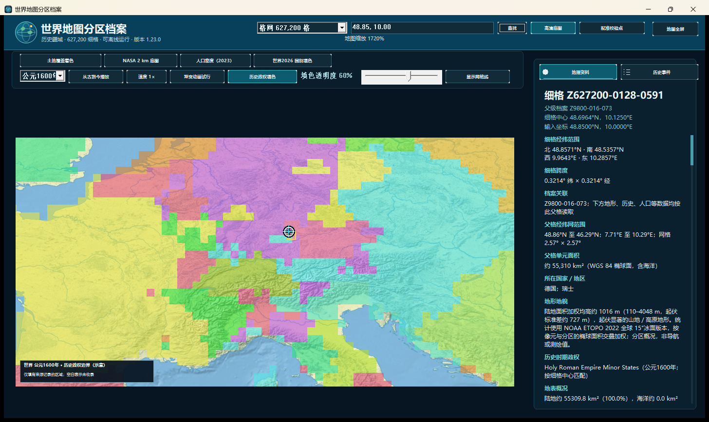](./screenshots/08d-history-europe-1600-detail-opacity-60.png) | [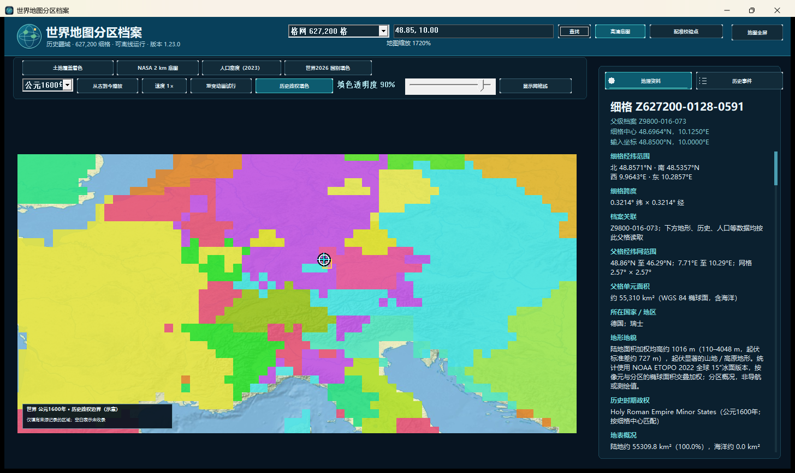](./screenshots/08c-history-europe-1600-detail-opacity-90.png) | [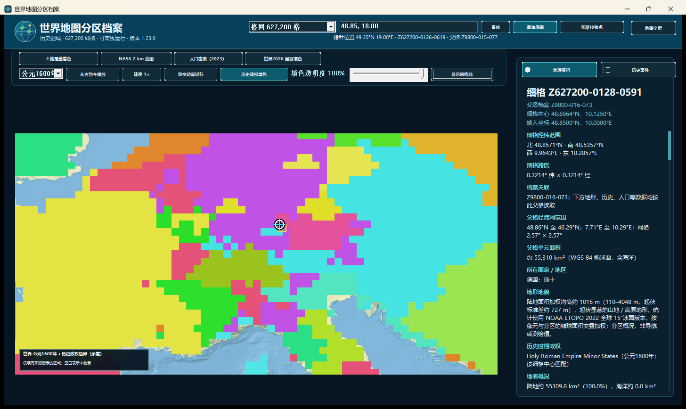](./screenshots/08e-history-europe-1600-detail-opacity-100.png) |

| 90% · 网格线关闭 | 同一视角 · 网格线开启 |
| --- | --- |
|  | [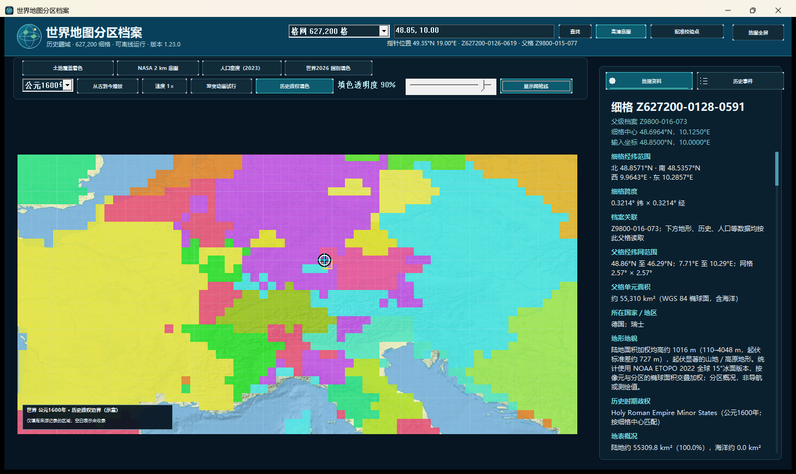](./screenshots/08f-history-europe-1600-detail-opacity-90-gridlines.png) |

完整画廊共 35 张原图，另含 25%／72%／100% 同视角透明度对照、8 个历史年份、2026 年国别、人口与土地覆盖局部图、历史事件和全屏地图。归档检查素材另见 [`1.23.0/qa`](./当前补丁/迭代工作/1.23.0/qa/)。

## 功能一览

- **浏览地图：** Natural Earth 标准及高清底图、NASA Blue Marble 底图；支持缩放、平移和全屏查看。
- **定位网格：** 提供 9,800、39,200、156,800 和 627,200 格四档经纬网格；可按编号、经纬度、地点或土地覆盖类别搜索。
- **查看历史：** 浏览 601 个历史时间点，时间范围从公元前 3400 年至公元 2024 年；历史事件面板收录 164 条事件、45 个类别。
- **切换专题：** 查看历史政权、2026 年国家／地区分类、2023 年人口估算和 2020 年土地覆盖图层。
- **离线使用：** 地图、数据和运行资源随完整发行包提供，日常浏览无需联网。

## 网格与资料口径

四档网格按经纬度划分，并非等面积网格，单格实际面积会随纬度变化。选择更细网格可以更精细地定位，但不代表关联资料具有更高空间分辨率。区域信息中的地形、地点和人口等摘要主要按 9,800 格基础网格汇总；历史疆域与 2026 年国别图层有各自的数据口径，详见随包的数据说明。

人口图层采用 WorldPop 模型估算，不是人口普查；源数据在约南纬 60°至北纬 84°以外不提供估值。历史疆域资料在不同年代和地区的覆盖程度不一，图上空白表示来源数据没有匹配记录，不表示无人居住，也不构成现行主权或法律边界结论。国别分色用于地图区分，不表示数值高低。

## 下载与启动

1. 从 [v1.23.0 发布页](https://github.com/zaohong/world-map-explorer/releases/tag/v1.23.0) 下载 `WorldMapExplorer-1.23.0.zip`。
2. 完整解压后，进入 `WorldMapExplorer-1.23.0` 文件夹。
3. 双击 `WorldMapExplorer.exe`。请保留同目录中的 `assets`、`data`、`licenses` 和数据来源说明文件。

压缩包 SHA-256：`476C02639BEADC6D1F3A42915A8894BE36CCAE478D16283BB48808BE712B0979`。两份较大的原始输入数据可从同一 Release 下载；恢复路径、许可和校验值见 [`SUPPLEMENTAL-DATA.md`](./SUPPLEMENTAL-DATA.md)。它们用于重建输入或核对数据，运行程序不需要另行下载。

## 仓库内容

| 路径 | 内容 |
| --- | --- |
| [`当前补丁/迭代工作/1.23.0/native`](./当前补丁/迭代工作/1.23.0/native/) | Windows 主程序、专题数据生成工具及相关源码 |
| [`当前补丁/迭代工作/1.23.0/source-data`](./当前补丁/迭代工作/1.23.0/source-data/) | 历史疆域、历史事件、Natural Earth 输入和来源说明 |
| [`当前补丁/迭代工作/1.23.0/qa`](./当前补丁/迭代工作/1.23.0/qa/) | 自动检查源码、运行记录和 35 张界面截图 |
| [`screenshots`](./screenshots/) | 按基础地图、专题图层和历史政权整理的 35 张高清界面展示图 |
| [`当前补丁/迭代工作/1.22.0`](./当前补丁/迭代工作/1.22.0/) | 保留的旧版源码、截图和检查记录 |
| [`当前补丁/迭代工作/必要数据源`](./当前补丁/迭代工作/必要数据源/) | 原始数据说明和重建工具 |
| [`交接文档`](./交接文档/) | 架构、来源、校准和历史变更资料 |
| [`原始输入`](./原始输入/) | 项目保留的原始地图输入 |

Git 仓库包含应用源码、构建输入、检查工具、记录和截图；编译好的完整 Windows 运行目录以 Release 压缩包提供。克隆仓库可浏览项目文件，下载发行包可直接运行应用。

## 1.23.0 检查记录

以下数字是随 1.23.0 归档的检查结果：

- 真实窗口交互：794 项通过，0 项失败。
- 历史疆域抽样：4,250 项通过，0 项失败。
- 网格与坐标逻辑：270 项通过，0 项失败。
- 历史事件、底图素材校验及各专题界面截图均已归档。

检查明细见 [`运行与功能检查.md`](./当前补丁/迭代工作/1.23.0/运行与功能检查.md) 和 [`qa`](./当前补丁/迭代工作/1.23.0/qa/) 文件夹。这里列出的结果对应 1.23.0 归档，并非重新执行的测试。

## 数据来源与许可

第三方数据和资源保留各自的来源说明与许可，详见运行包内的 `DATA_SOURCES.md`、`licenses/` 和源码目录中的来源文件。WorldPop 数据按 CC BY 4.0 保留署名；Natural Earth 数据为公有领域资料。应用源码目前未单独指定开源许可证；公开浏览源码不代表取得未明确授权内容的再分发或商用许可。

