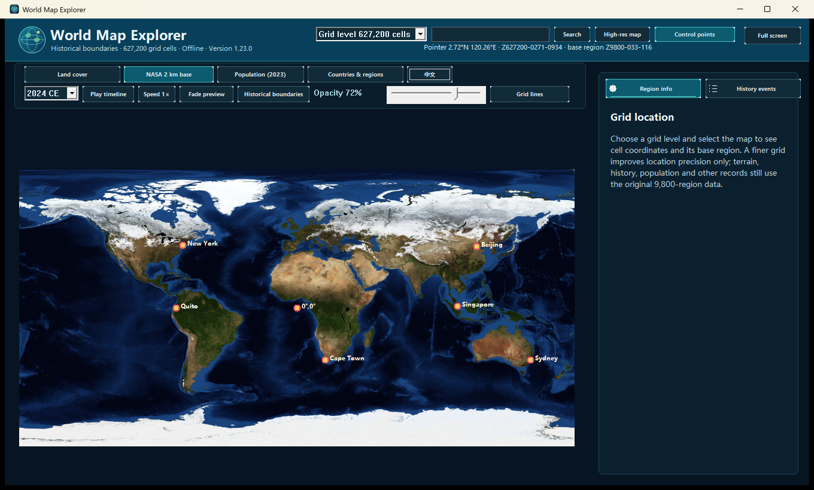
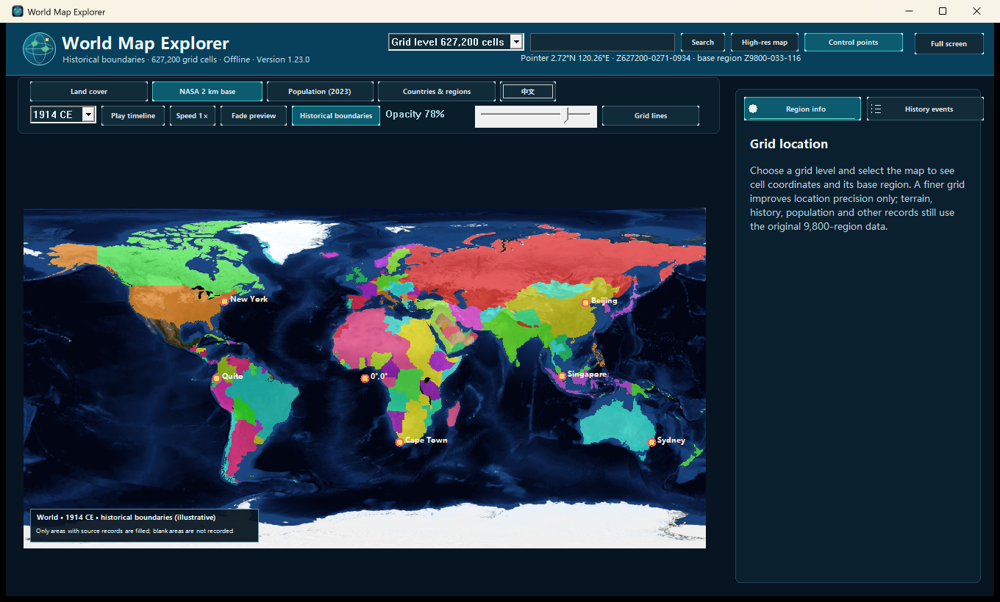

# English Screenshot Selection

These two full-window captures present the English interface on the NASA Blue Marble basemap. The first shows the global map and grid controls; the second shows 1914 historical boundaries with the NASA basemap.

> These images come from a local bilingual preview build and are not part of the downloadable v1.23.0 program. The current public release remains Chinese-only. The database has not been translated, so selected region records may still contain Chinese text.

## Global NASA basemap

Grid level: 627,200 cells. Grid lines are hidden in this global view so the basemap remains clear.

## 1914 historical boundaries on NASA

The screenshot shows the 1914 CE layer at 78% opacity, with grid lines hidden. Blank areas indicate that the source set has no matching record.

## Full gallery

- [Complete 35-image Chinese interface gallery](./README.md)
- [Project overview and download](../README.md)
- [Current public v1.23.0 release](https://github.com/zaohong/world-map-explorer/releases/tag/v1.23.0)