# 1.28.0 实际界面 / Screenshot gallery

全部图片来自本次公开发布的 Windows 1.28.0 程序。拍摄使用隔离配置，未读取个人收藏。系统缩放 200%，程序跟随系统；点击图片查看原尺寸。底图与专题来源见 [资料说明](../docs/DATA_SOURCES.md)。

All images show the released 1.28.0 executable, captured with a fresh isolated profile at 200% Windows scaling. Some original database text retains its source language.

[返回中文首页](../README.md) · [English](../README.en.md)

## 中文主界面 · Natural Earth 全球地形

Chinese interface and terrain overview

[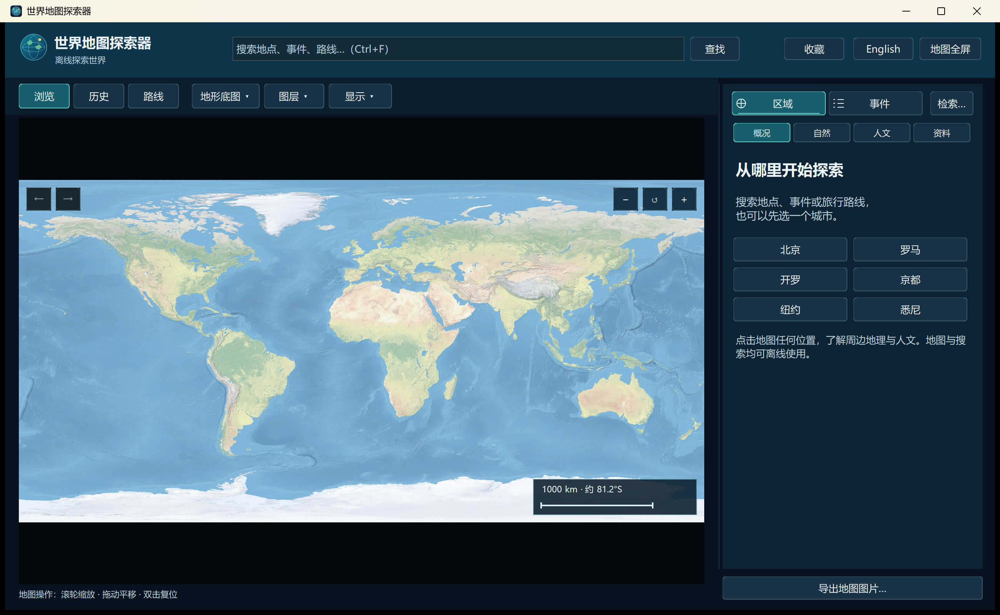](01-world-overview-zh.png)

## NASA Blue Marble 全球底图

NASA Blue Marble overview

[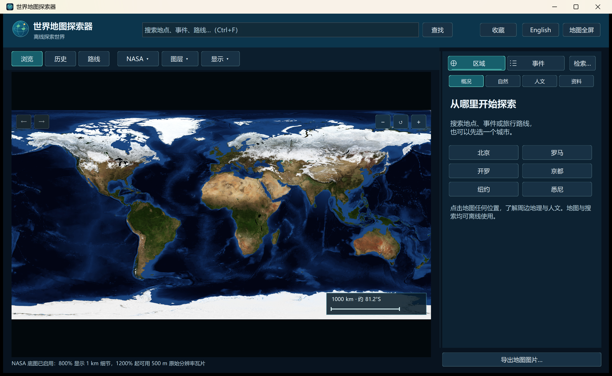](02-nasa-overview-zh.png)

## 北京 · 地点来源坐标与区域人文阅读

Beijing source coordinates and region reading

[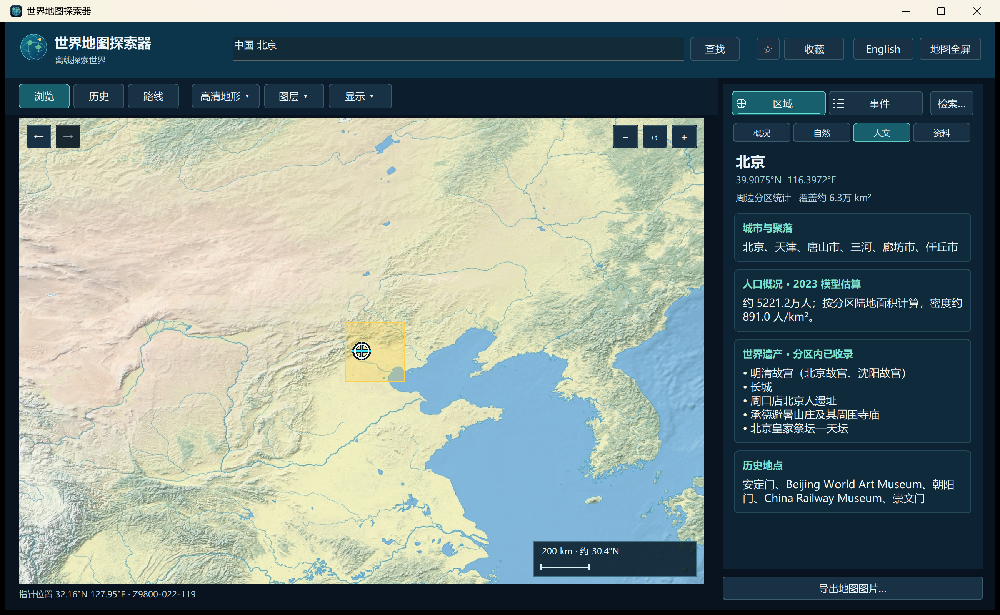](03-beijing-region-zh.png)

## 收藏 · 打开、重命名和取消收藏

Saved-place management

[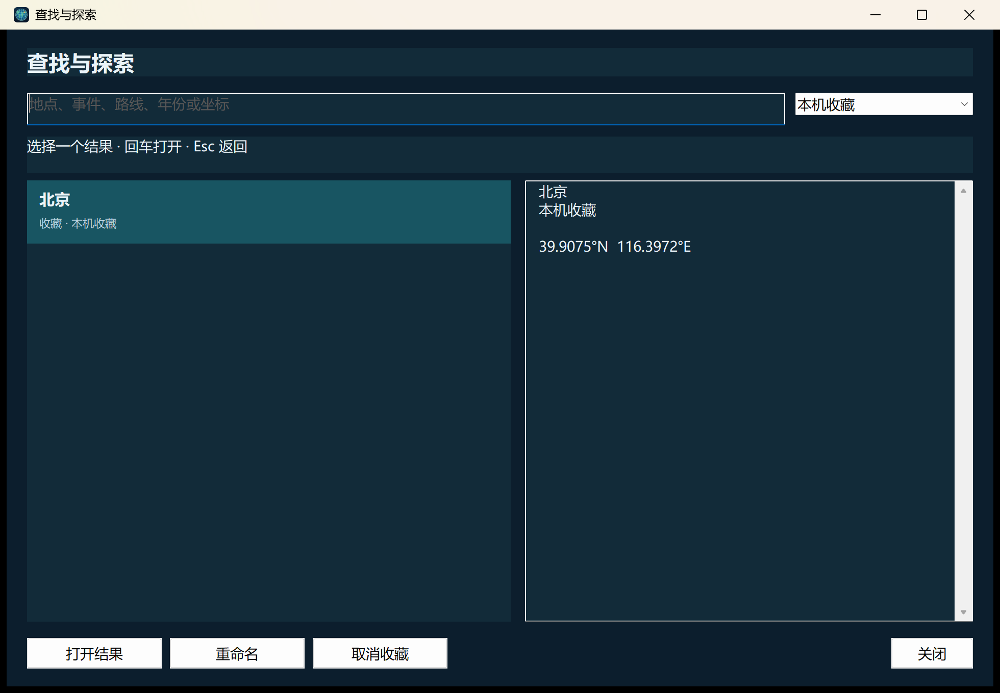](04-saved-places-zh.png)

## London Ontario · 国家／地区限定检索

Country-qualified unified search

[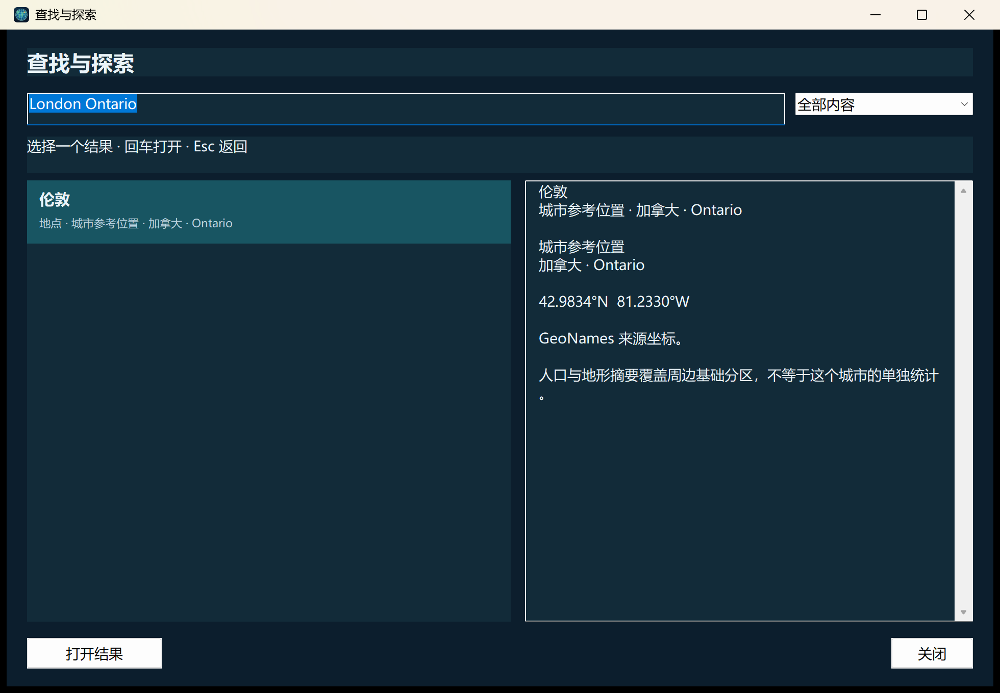](05-unified-search-en-query.png)

## 1600 年欧洲 · 来源矢量边界

Source-vector historical boundaries, 1600 CE

[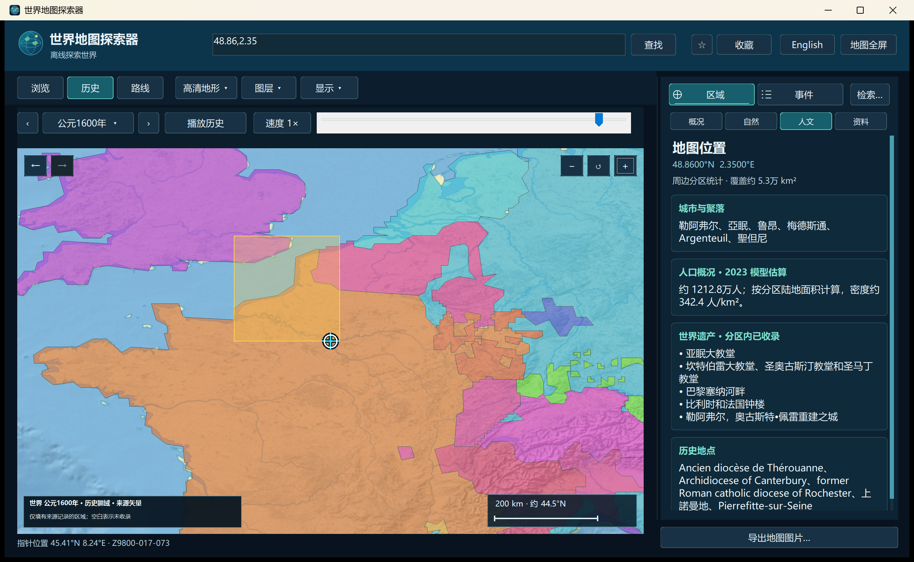](06-history-1600-zh.png)

## 阿波罗 · 独立历史事件检索

Historical-event search

[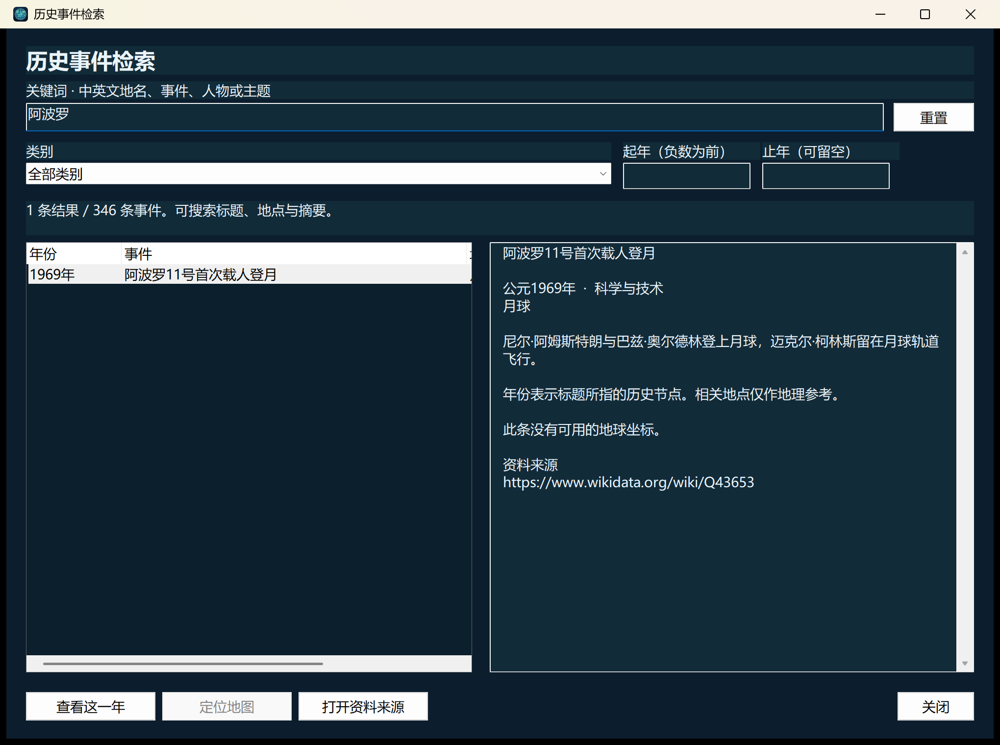](07-event-search-zh.png)

## 小猎犬号 · 参考路线与进度

HMS Beagle reference journey

[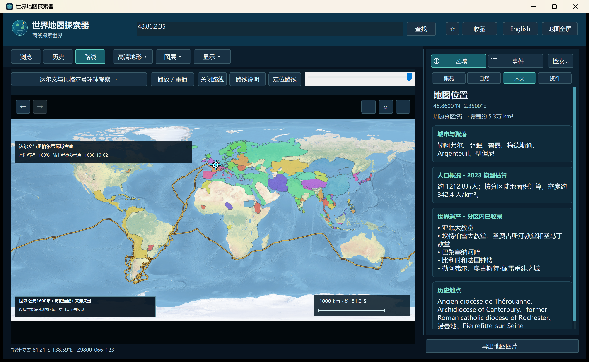](08-beagle-journey-zh.png)

## 路线资料 · 来源位置、日期和缺口

Journey positions, chronology and source gaps

[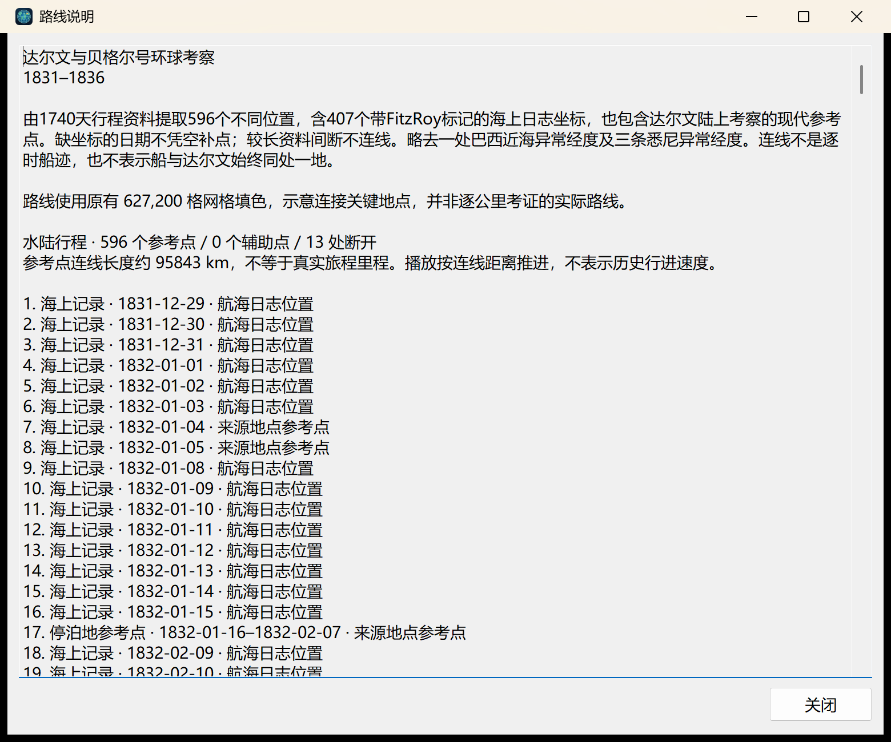](09-beagle-source-notes-zh.png)

## WorldPop 2023 · 人口估算图层

WorldPop 2023 population estimates

[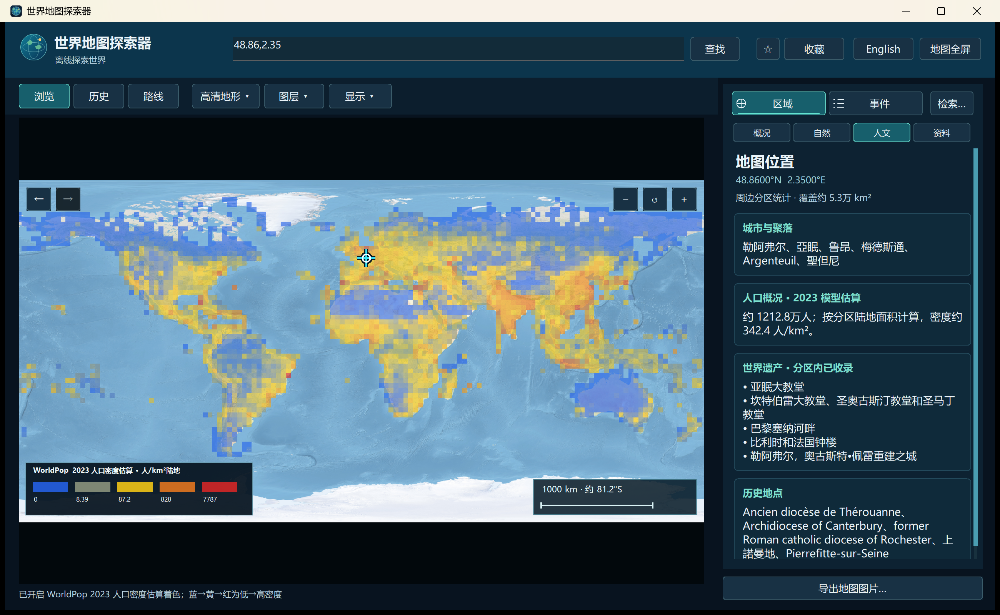](10-population-2023-zh.png)

## 2020 年土地覆盖预览

2020 land-cover preview

[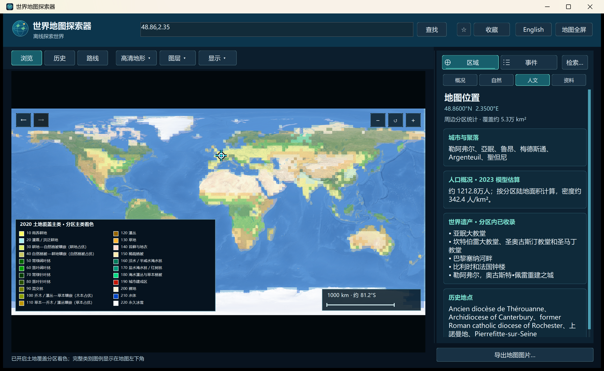](11-land-cover-2020-zh.png)

## 英文界面 · 北京资料

English interface and Beijing reading

[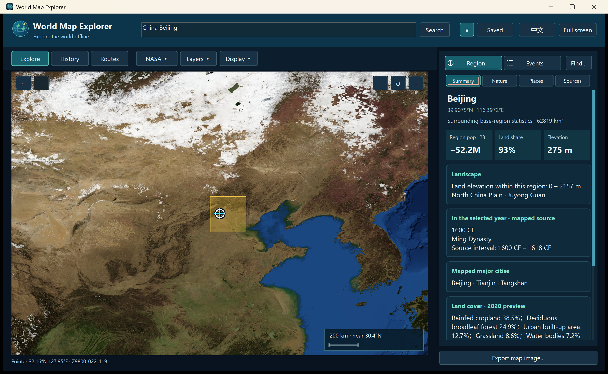](12-english-beijing.png)

## 英文界面 · 路线工作区

English journey workspace

[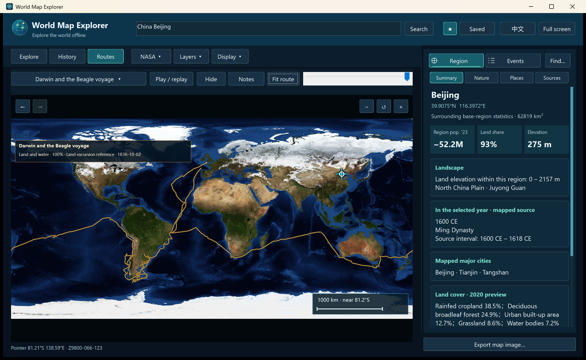](13-english-journey.png)

## 英文界面 · NASA 全球概览

English NASA overview

[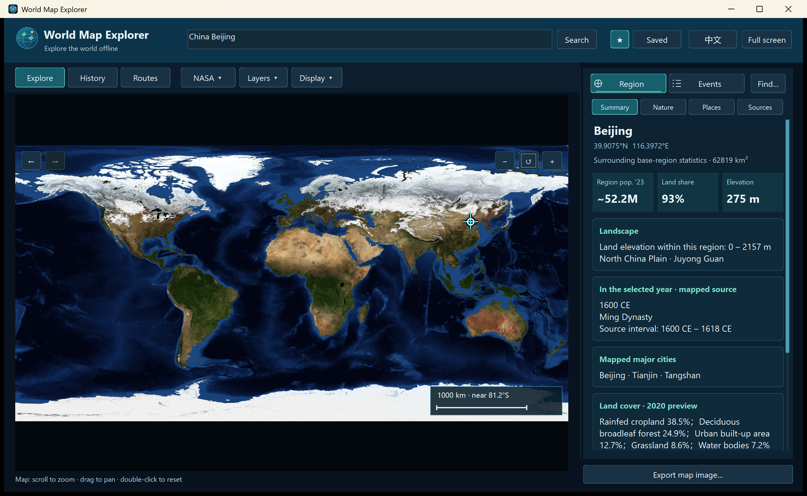](14-english-overview.png)
