# 1.23.0 界面截图画廊

本目录按“基础地图与专题”和“历史政权”两部分整理了 35 张完整界面 PNG。多数原图尺寸为 1456 × 868 像素；全屏地图为 1440 × 900 像素。点击图片可打开原图。英文界面精选图见[English screenshot selection](./README.en.md)；两张预览图来自尚未发布的本地双语版本，当前 v1.23.0 下载包仍为中文界面，数据库内容暂不翻译。

- Natural Earth 部分使用 Natural Earth 10m 高清底图；NASA 部分使用 NASA Blue Marble 与应用内可用的 1 km、500 m 细节影像。
- 网格档位统一选择 627,200 格。网格线对照图使用相同地点、相同缩放比例，仅切换网格线状态。
- 历史时期图均开启对应年份的历史政权填色；同组对照图保持年份、地点和缩放一致。
- 项目里的专题图层是 **2020 年土地覆盖**，不是土壤成分或土壤类型图。其余专题图层为 2026 年国别分类与 WorldPop 2023 人口估算。

## 一、基础地图与专题

### 两张全球高清底图

| Natural Earth 10m | NASA Blue Marble |
| --- | --- |
| **01 · Natural Earth 10m 全球高清底图** <a href="./01-world-overview.png">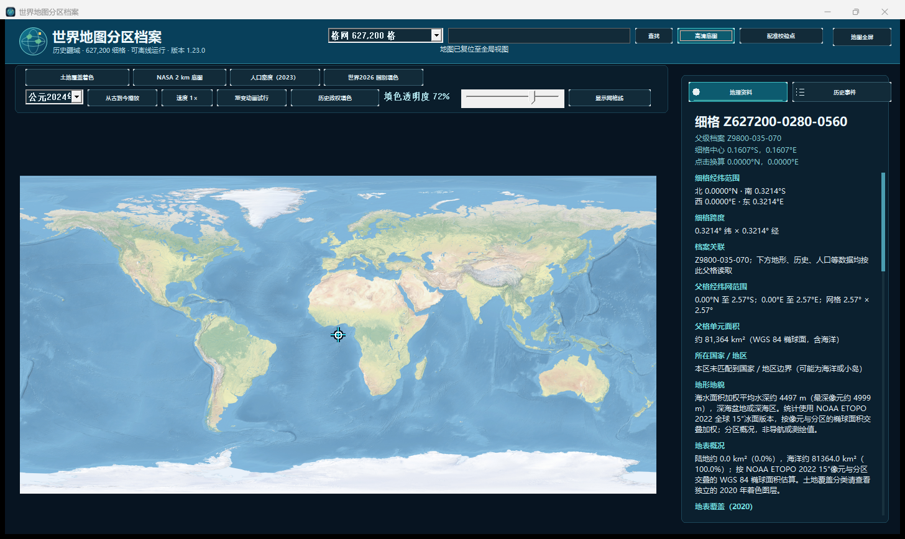</a> | **16 · NASA Blue Marble 全球底图** <a href="./16-nasa-blue-marble.png">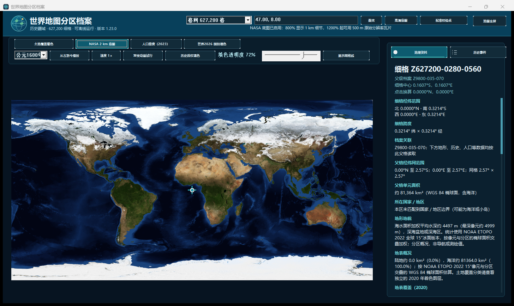</a> |

### Natural Earth 高清底图局部放大（4 个地区）

| 欧洲 | 非洲 |
| --- | --- |
| **15 · 欧洲地形细节** <a href="./15-natural-earth-high-resolution.png">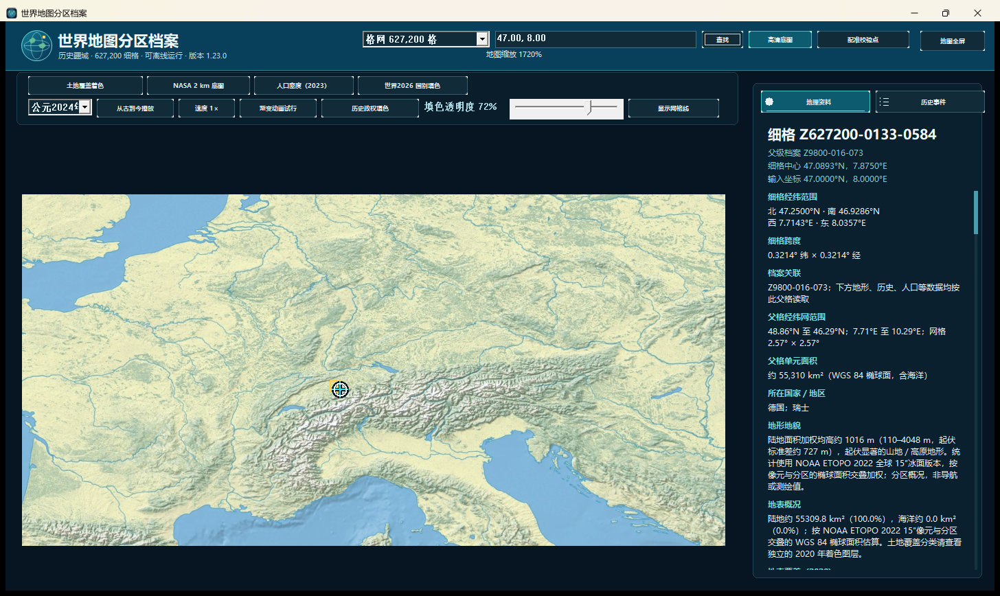</a> | **15a · 非洲地形细节** <a href="./15a-natural-earth-africa-detail.png">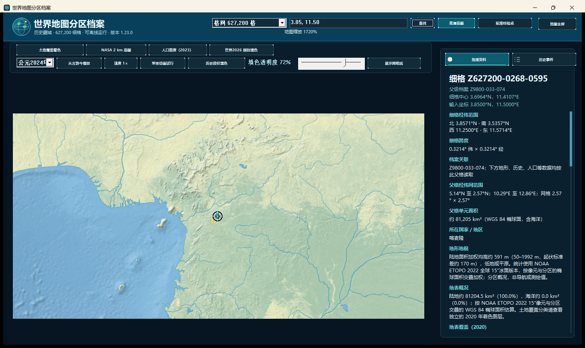</a> |

| 安第斯山脉 | 喜马拉雅山脉 |
| --- | --- |
| **15b · 安第斯山脉地形细节** <a href="./15b-natural-earth-andes-detail.png">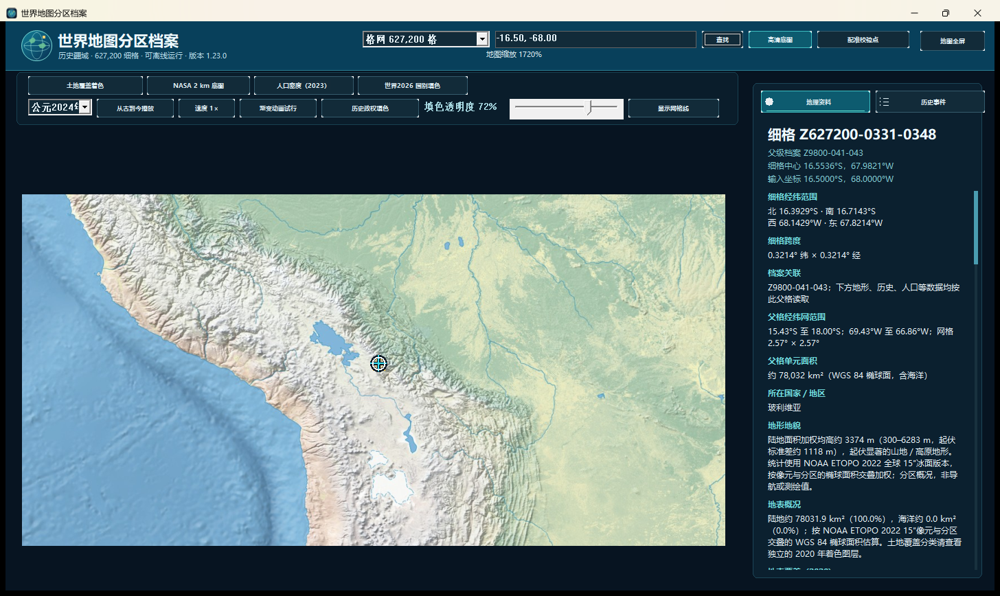</a> | **15c · 喜马拉雅山脉地形细节** <a href="./15c-natural-earth-himalaya-detail.png">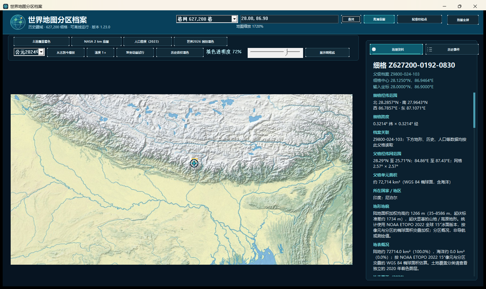</a> |

### 627,200 格网格线开／关对照

| 显示网格线 | 隐藏网格线 |
| --- | --- |
| **02 · 日本局部高精度网格定位，网格线开启** <a href="./02-fine-grid-location.png">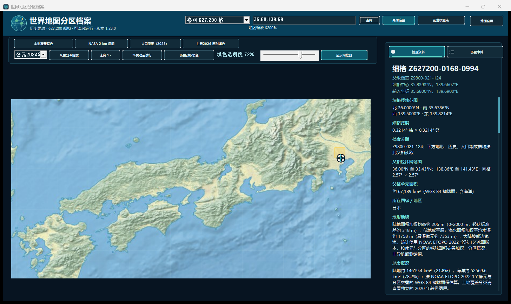</a> | **02a · 同一视角，网格线关闭** <a href="./02a-fine-grid-location-no-gridlines.png">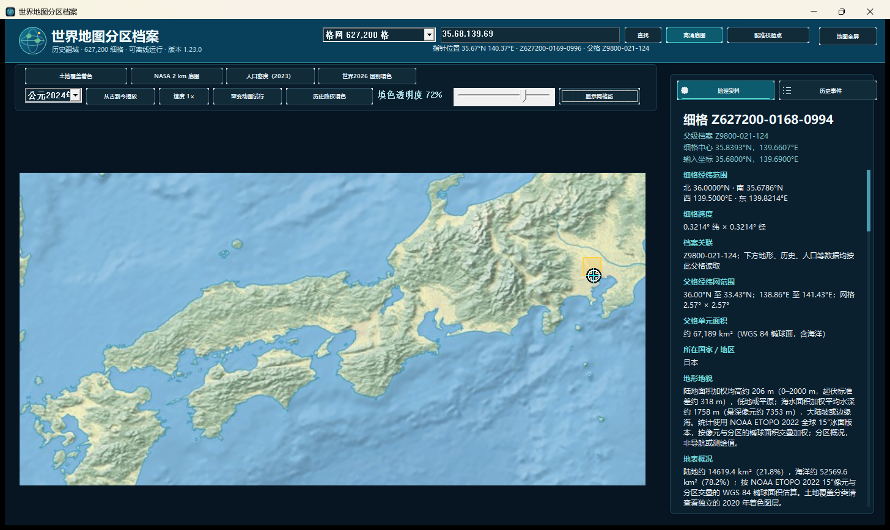</a> |

非洲中部的高精度网格定位与网格线示例见 **03**：

### 人口与土地覆盖

| WorldPop 2023 人口估算 | 南亚人口局部图 |
| --- | --- |
| **11 · 全球人口密度估算** <a href="./11-population-2023.png">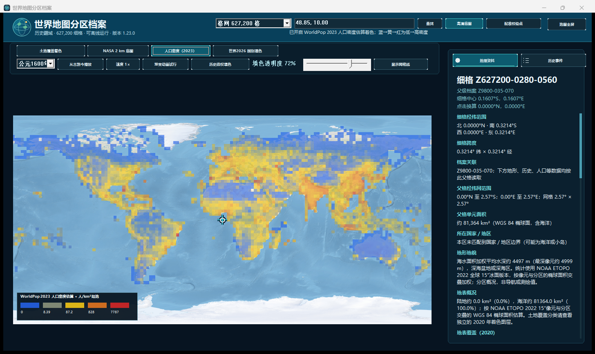</a> | **12 · 南亚人口放大图**  |

| 2020 年土地覆盖 | 非洲土地覆盖局部图 |
| --- | --- |
| **13 · 全球土地覆盖类别** <a href="./13-land-cover-2020.png">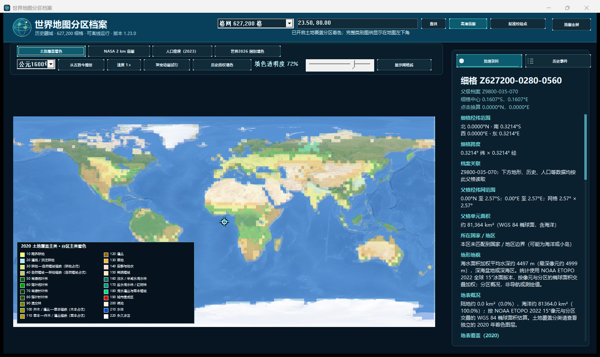</a> | **14 · 非洲土地覆盖类别**  |

### 其他专题与底图细节

| 2026 年国别分类 | 欧洲国别放大图 |
| --- | --- |
| **09 · 2026 年国家／地区填色**  | **10 · 欧洲国别局部图**  |

| NASA 1 km 细节 | NASA 500 m 细节 |
| --- | --- |
| **17 · NASA 1 km 影像细节**  | **18 · NASA 500 m 影像细节**  |

| 历史事件面板 | 全屏高清地图 |
| --- | --- |
| **19 · 历史事件浏览**  | **20 · 高清底图全屏浏览**  |

## 二、历史政权

### 八个历史时间点（全球视图）

从公元前 1000 年至公元 2024 年，均开启对应年份的历史政权填色。图上空白表示来源资料未收录相应记录。

| 公元前 1000 年 | 公元 476 年 |
| --- | --- |
| **历史填色** <a href="./history-1000-bce.png">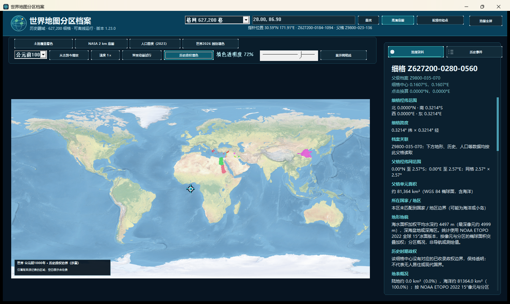</a> | **历史填色** <a href="./history-0476.png">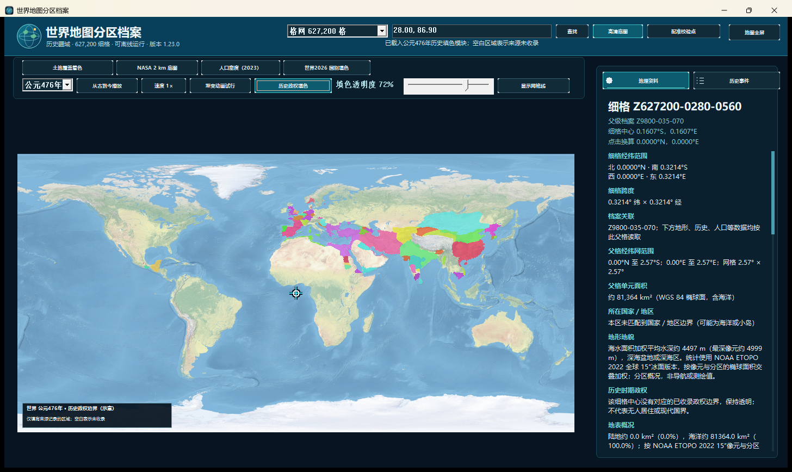</a> |

| 公元 1000 年 | 公元 1200 年 |
| --- | --- |
| **04 · 历史填色**  | **历史填色** <a href="./history-1200.png">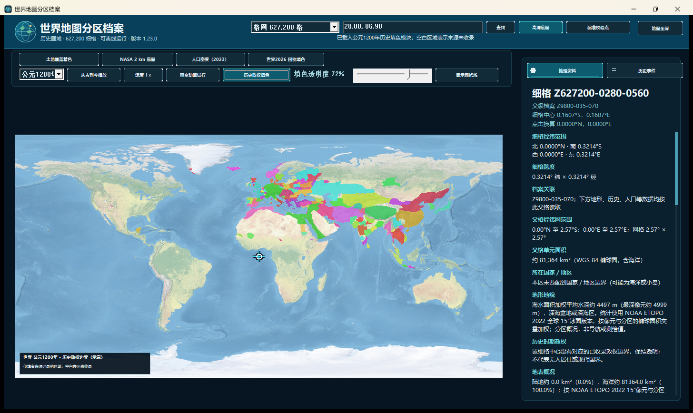</a> |

| 公元 1600 年 | 公元 1800 年 |
| --- | --- |
| **05 · 历史填色**  | **06 · 历史填色**  |

| 公元 1914 年 | 公元 2024 年 |
| --- | --- |
| **历史填色** <a href="./history-1914.png">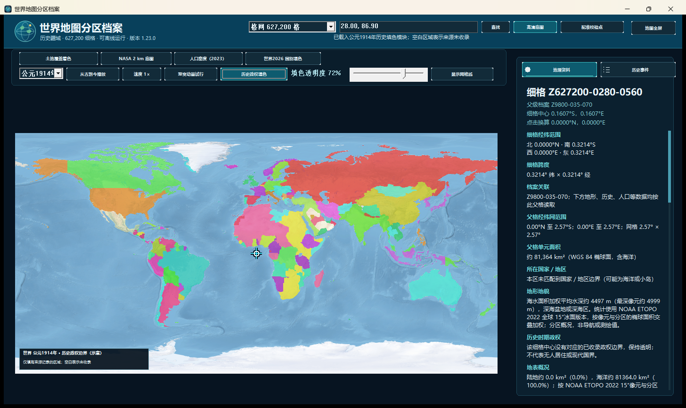</a> | **07 · 历史填色**  |

### 公元 1600 年历史填色透明度对比（同一欧洲视角）

| 25% | 72% 默认值 | 100% |
| --- | --- | --- |
| **08a**  | **08 · 默认透明度**  | **08b**  |

### 历史疆域局部放大与透明度对照

同一欧洲局部放大图分别显示 60%、90%、100% 透明度。90% 视角再以网格线开／关各展示一次。

| 60% | 90% · 网格线关闭 | 100% |
| --- | --- | --- |
| **08d** <a href="./08d-history-europe-1600-detail-opacity-60.png">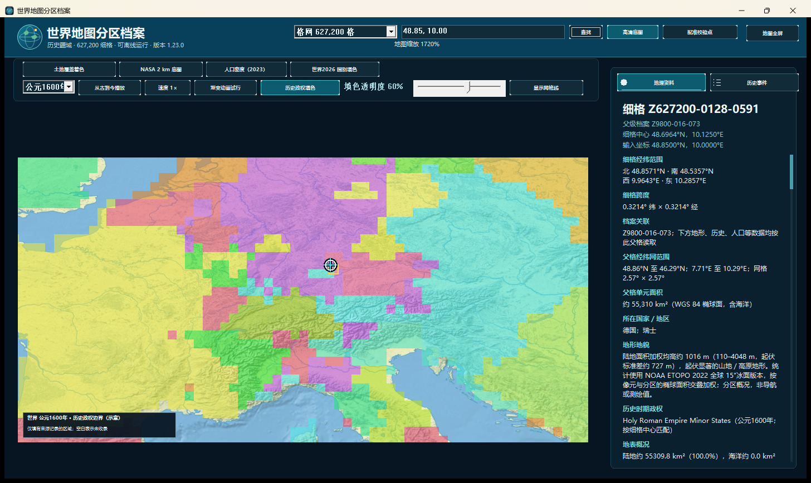</a> | **08c** <a href="./08c-history-europe-1600-detail-opacity-90.png">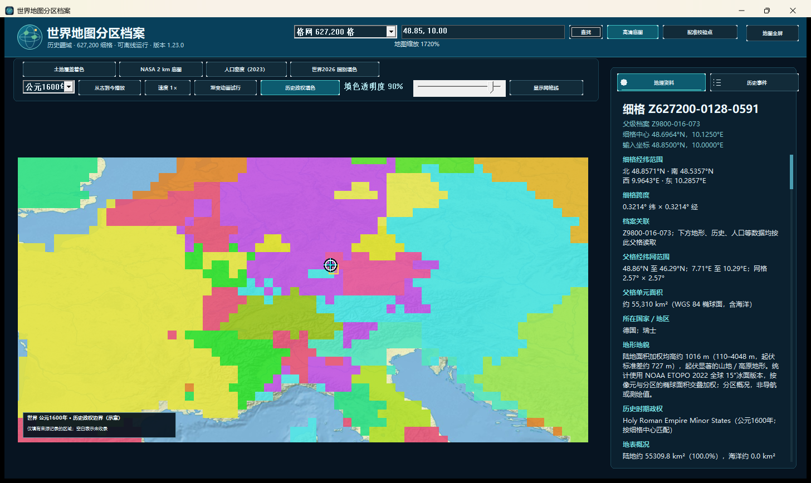</a> | **08e** <a href="./08e-history-europe-1600-detail-opacity-100.png">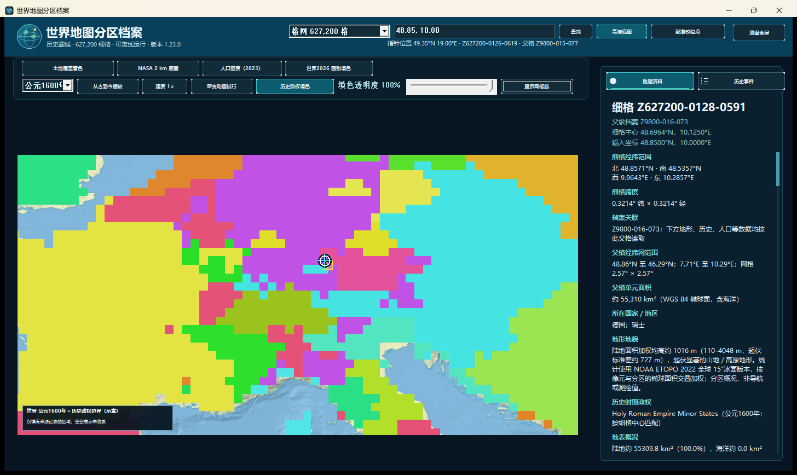</a> |

| 局部历史图 · 网格线关闭 | 同一视角 · 网格线开启 |
| --- | --- |
| **08c · 90% 透明度**  | **08f · 90% 透明度** <a href="./08f-history-europe-1600-detail-opacity-90-gridlines.png">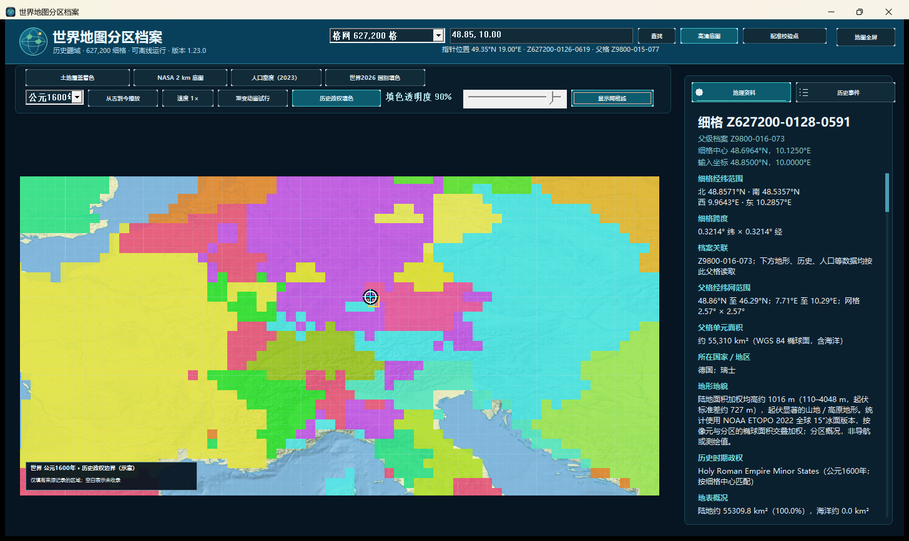</a> |

### 全球历史图与 NASA 底图叠加

| 全球 1600 年历史图 | NASA 底图 + 1600 年历史填色 |
| --- | --- |
| **05 · Natural Earth 高清底图**  | **16a · NASA Blue Marble** <a href="./16a-history-1600-nasa-base.png">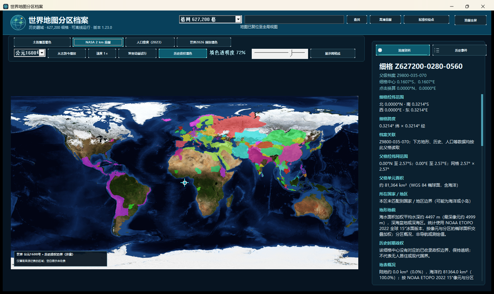</a> |
