# 1.23.0 界面截图画廊

本目录保存 22 张来自完整运行版 1.23.0 的全界面 PNG，原图尺寸约为 1456 × 868 像素；点击预览即可查看或下载原图。

- Natural Earth 展示图均启用了 Natural Earth 10m 高清底图；NASA 组使用 NASA Blue Marble 底图及其 1 km、500 m 细节影像。
- 地图定位档位设为 627,200 格。细格定位特写开启网格线，其余视图减少网格线以保持地图清楚。
- 历史截图已开启对应年份的历史政权填色；2026 年国别、WorldPop 2023 人口和 2020 年土地覆盖各自单独展示。
- 透明度对照使用相同的公元 1600 年欧洲视角，分别显示 25%、72% 默认值和 100%。

## 世界底图与细格定位

| 全球高清底图 | 日本细格定位 |
| --- | --- |
| **01 · Natural Earth 10m 全球底图**  | **02 · 日本 627,200 格细格定位**  |

| 非洲局部与细格 | Natural Earth 高清细节 |
| --- | --- |
| **03 · 非洲中部高清放大与细格** <a href="./03-africa-detail.png">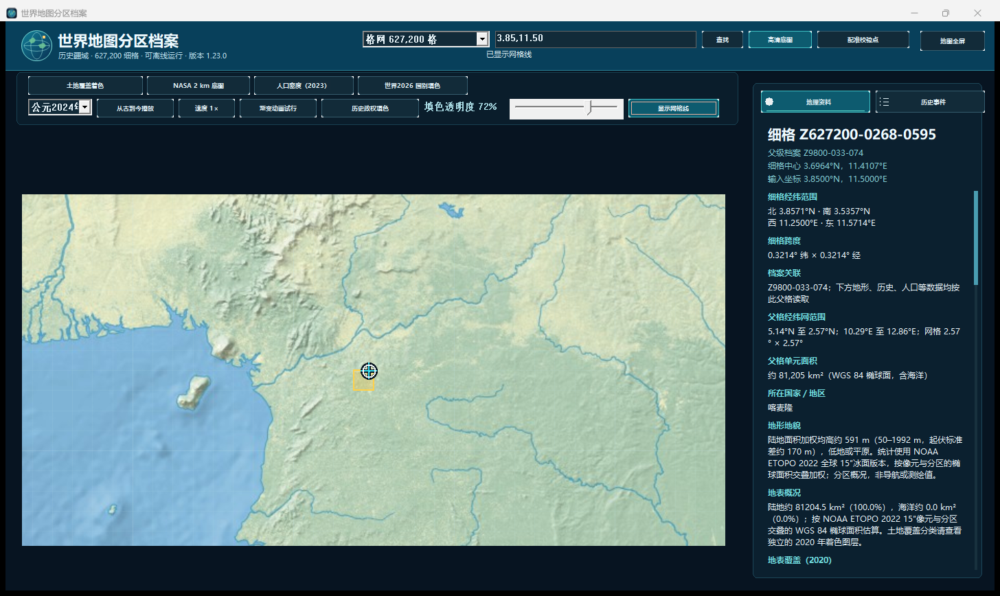</a> | **15 · 欧洲 Natural Earth 高清细节**  |

## 历史政权与填色透明度

| 公元 1000 年 | 公元 1600 年 |
| --- | --- |
| **04 · 历史政权填色** <a href="./04-history-1000.png">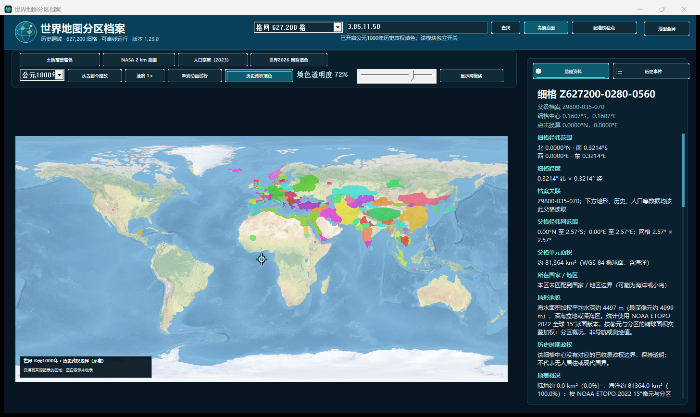</a> | **05 · 历史政权填色** <a href="./05-history-1600.png">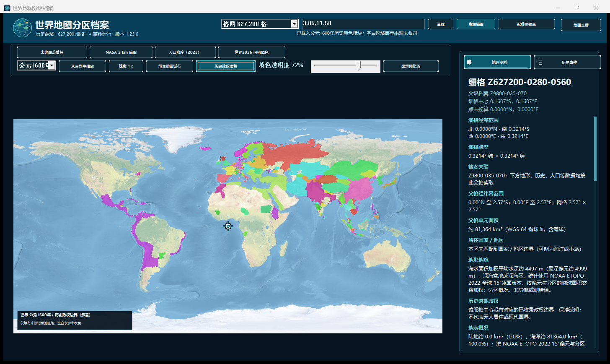</a> |

| 公元 1800 年 | 公元 2024 年 |
| --- | --- |
| **06 · 历史政权填色** <a href="./06-history-1800.png">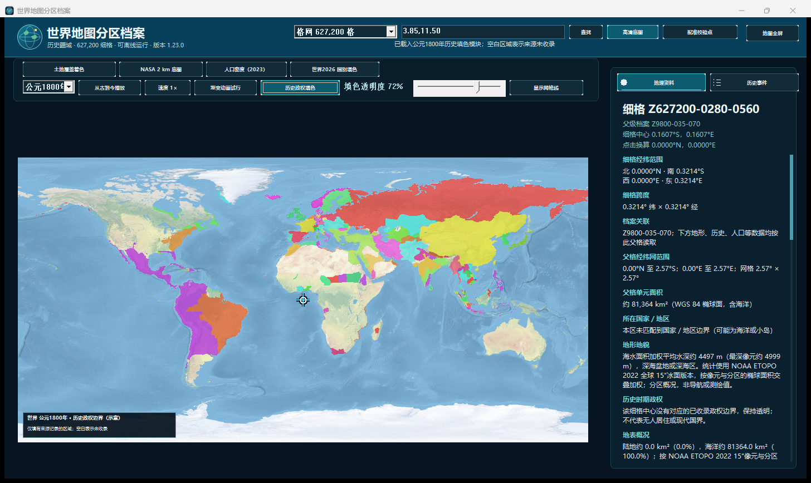</a> | **07 · 历史政权填色** <a href="./07-history-2024.png">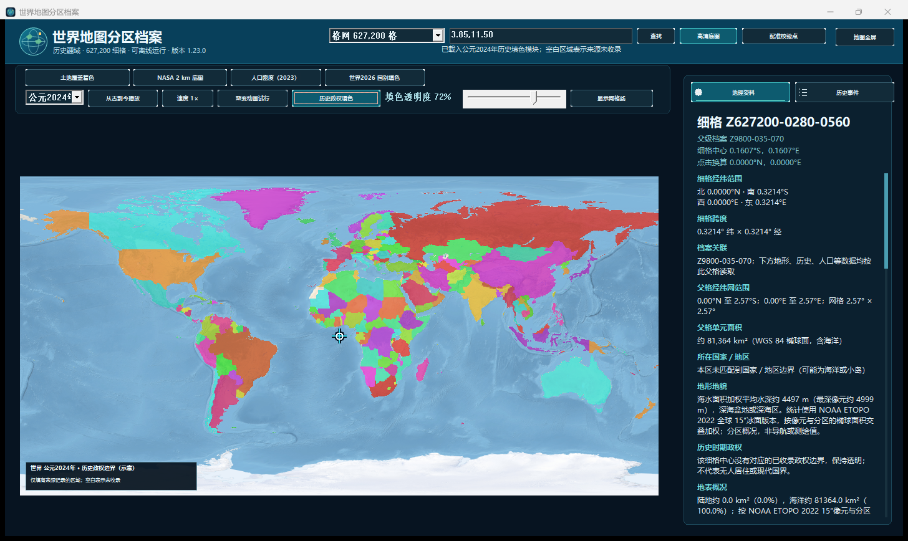</a> |

| 72% 默认透明度 | 25% 透明度 |
| --- | --- |
| **08 · 公元 1600 年欧洲历史图，默认 72%**  | **08a · 同一视角，25%** <a href="./08a-history-europe-1600-opacity-25.png">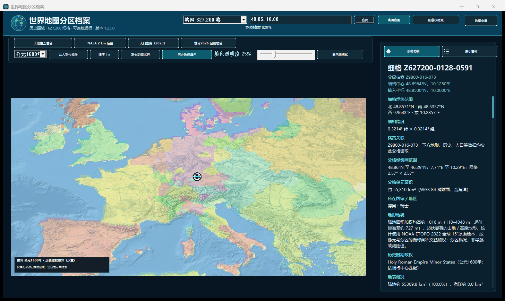</a> |

| 100% 透明度 |
| --- |
| **08b · 同一视角，100%** <a href="./08b-history-europe-1600-opacity-100.png">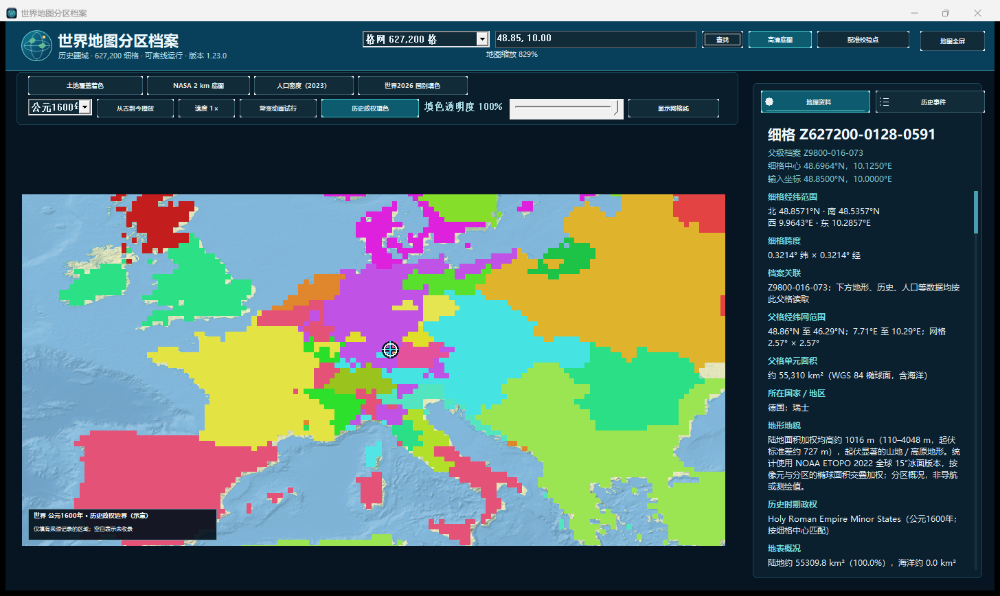</a> |

## 国别与专题图层

| 2026 年国家与地区分类 | 欧洲国别放大图 |
| --- | --- |
| **09 · 2026 年国别填色** <a href="./09-country-regions-2026.png">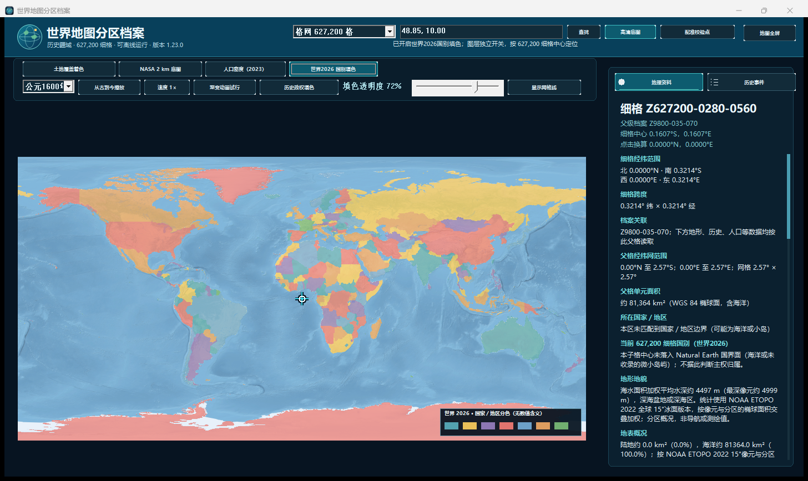</a> | **10 · 欧洲国别放大图** <a href="./10-country-europe-zoom.png">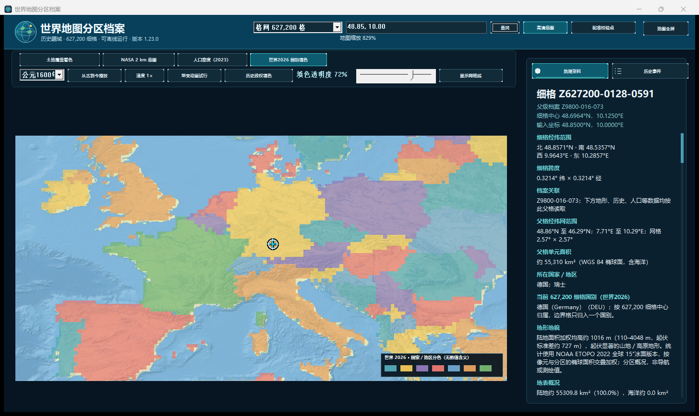</a> |

| WorldPop 2023 人口 | 南亚人口放大图 |
| --- | --- |
| **11 · WorldPop 人口密度估算**  | **12 · 南亚人口密度放大图** <a href="./12-population-south-asia.png">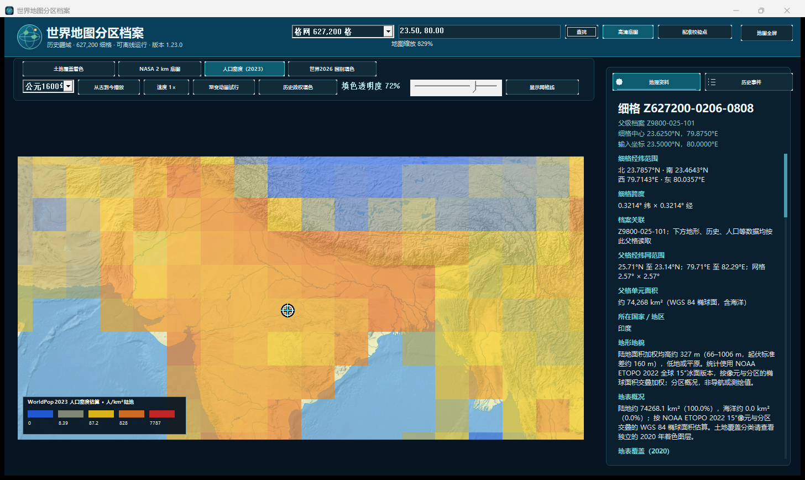</a> |

| 2020 年土地覆盖 | 非洲土地覆盖放大图 |
| --- | --- |
| **13 · 全球土地覆盖类别**  | **14 · 非洲土地覆盖类别** <a href="./14-land-cover-africa.png">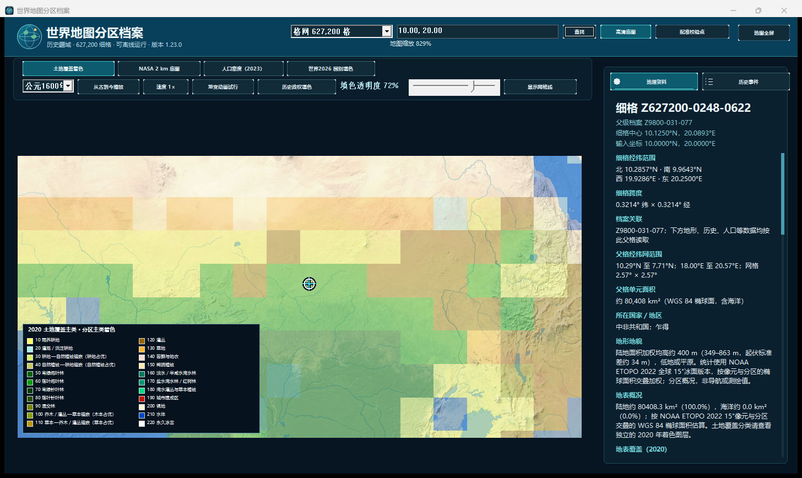</a> |

## NASA Blue Marble 与高分辨率细节

| NASA 全球底图 | 1 km 细节 |
| --- | --- |
| **16 · NASA Blue Marble 全球影像**  | **17 · NASA 1 km 卫星影像** <a href="./17-nasa-detail-1km.png">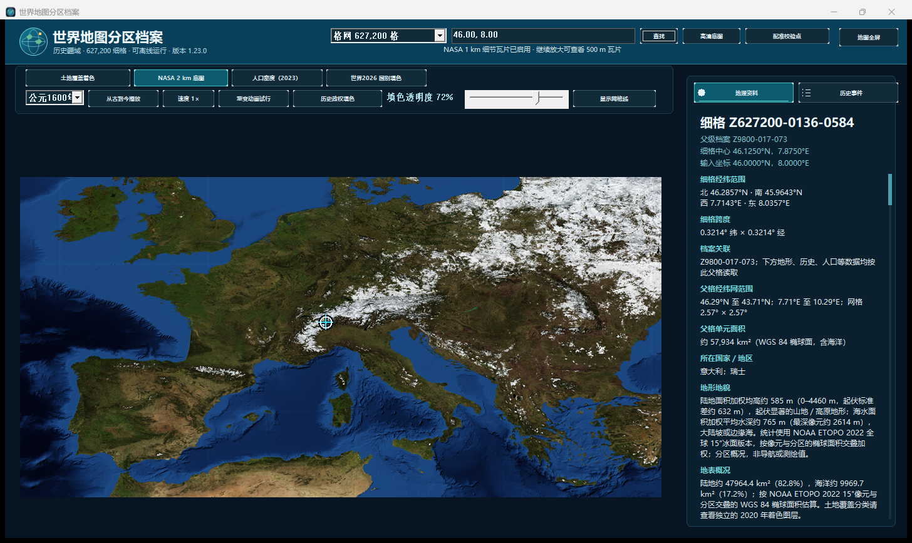</a> |

| 500 m 细节 |
| --- |
| **18 · NASA 500 m 卫星影像** <a href="./18-nasa-detail-500m.png">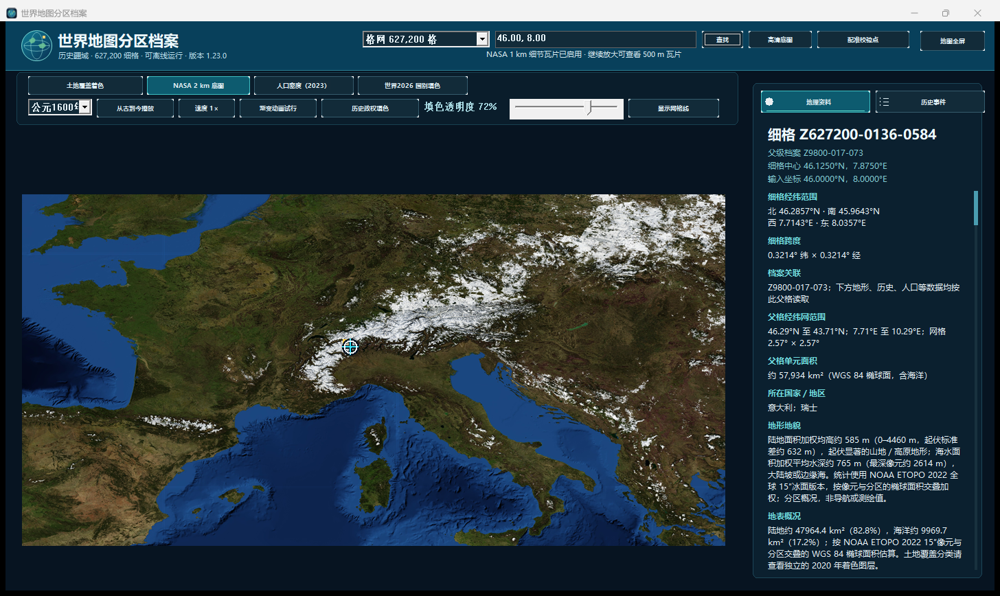</a> |

## 历史事件与全屏地图

| 历史事件面板 | 全屏地图 |
| --- | --- |
| **19 · 历史事件浏览** <a href="./19-historical-events.png">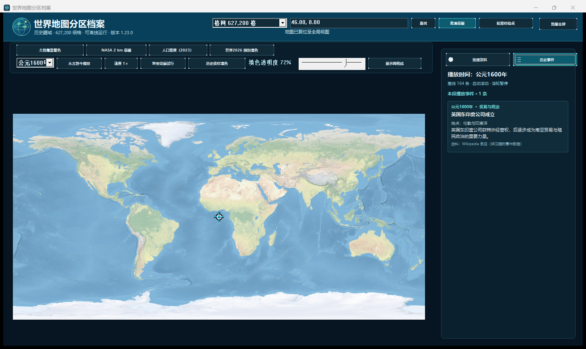</a> | **20 · 高清底图全屏浏览** <a href="./20-fullscreen-map.png">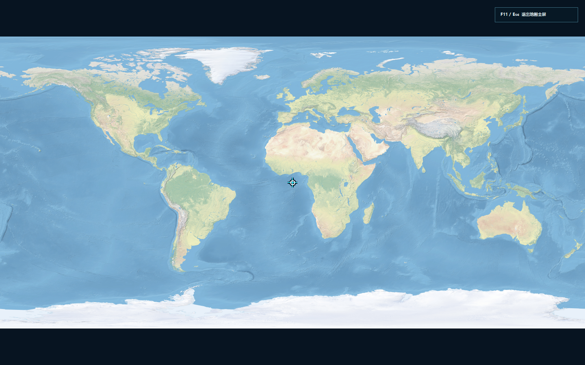</a> |
